# LOG_ON Portfolio — Complete Product & Operational Flowchart Specification

**Purpose:** one portfolio-wide reference that lists every project, product, platform, research stream, component, proposed-name track and historical prototype recovered from the conversation record, with a distinct product/user flow and operational/system flow for each track.

**Evidence boundary:** this is a conversation-derived architecture baseline, not a live repository audit. Project existence, current branch, implementation completeness, integrations, customers, deployment and production readiness must be verified against the relevant repository or source document. The flows are proposed baselines where implementation evidence is unavailable.

## How to read this document

- **Product flow** describes the user, customer, researcher or operator journey and the value or artifact they receive.
- **Operational flow** describes internal processing, data/policy checks, execution, verification, failure handling and audit evidence.
- **Ongoing** means the initiative remains in the portfolio; it does not mean deployed or production-ready.
- **Proposed-name product track** means use the displayed working name in the portfolio and diagrams. It does not mean the track is excluded or inactive.
- **Research/component/historical** items are retained as portfolio tracks with workflows appropriate to their nature; they are not misrepresented as independent SaaS products.
- In each diagram, the “No” path is a safe failure, clarification, review or remediation route. Product-specific acceptance tests must map to every decision gate.

## Portfolio-wide architecture boundaries

The following boundaries must remain explicit:

1. **LOG_ON** owns commercial packaging, customer discovery, deployment, adoption, support and business-outcome measurement.
2. **AgentBridge-Africa** is the agent execution and authorization infrastructure track.
3. **ArchAudit-CCM** evaluates controls and maintains deterministic evidence; it is not the agent runtime.
4. **PAL** handles culturally grounded multilingual meaning and human-approved action proposals; Sahara/STT, OMI and the Meaning-to-Action Kernel are related but distinct components.
5. **ContextPocket, RecallGrid and Re:Mind Me** are related to context and memory but have different product boundaries: agent memory infrastructure, memory mesh concept and personal reminder/memory workflow.
6. **MorrowVoice** owns principal-centred consent authority for its scope; voice interfaces must not independently grant authority.
7. Products integrate through explicit contracts. Data, identity, permissions and execution authority do not transfer by default.

## Portfolio register

| # | Group | Project / display name | Classification | Portfolio status |
|---:|---|---|---|---|
| 1 | LOG_ON commercial systems | **LOG_ON Agency & LOG_ON OS** | Commercial platform / operating system | Ongoing portfolio core |
| 2 | LOG_ON commercial systems | **LOGON Insights Hub** | Business intelligence product / module | Ongoing initiative |
| 3 | LOG_ON commercial systems | **LOG_ON Reputation Intelligence** | Reputation and customer intelligence system | Ongoing initiative |
| 4 | LOG_ON commercial systems | **LOG_ON Growth Systems** | Commercial service / reusable business workflows | Ongoing initiative |
| 5 | LOG_ON commercial systems | **Hotel / Clinic / Professional / SME OS** | Vertical business operating-system family | Ongoing product family |
| 6 | LOG_ON commercial systems | **Opportunity Exploration Engine / Pan-African Opportunity Scanner** | Opportunity intelligence product | Ongoing initiative |
| 7 | LOG_ON commercial systems | **Global AI Business Intelligence Agent / OpenServ track** | Research and agent initiative | Ongoing initiative; OpenServ integration was planned |
| 8 | LOG_ON commercial systems | **LOG_ON Agent Assurance** | Assurance platform / service | Ongoing strategic workstream |
| 9 | Agent infrastructure and assurance | **AgentBridge-Africa** | Agent infrastructure / middleware | Ongoing project |
| 10 | Agent infrastructure and assurance | **ArchAudit-CCM** | Continuous control monitoring / assurance | Ongoing project |
| 11 | Agent infrastructure and assurance | **SafeChain** | Blockchain-oriented decision logging and assurance | Ongoing / historical MVP testnet initiative |
| 12 | Agent infrastructure and assurance | **GRC Agent Studio** | Governance, risk and compliance automation | Ongoing initiative |
| 13 | Agent infrastructure and assurance | **Relaywise** | Proposed-name product track | Ongoing design/build track |
| 14 | Agent infrastructure and assurance | **FlowRail** | Proposed-name product track | Ongoing design/build track |
| 15 | Agent infrastructure and assurance | **SignalLedger** | Proposed-name product track | Ongoing design/build track |
| 16 | Agent infrastructure and assurance | **FoundryKit** | Proposed-name product track | Ongoing design/build track |
| 17 | Agent infrastructure and assurance | **PatchPilot** | Proposed-name product track | Ongoing design/build track |
| 18 | Agent infrastructure and assurance | **Cognitive Protocol** | Capability assurance / interaction protocol | Ongoing research/product initiative |
| 19 | Agent infrastructure and assurance | **FDE-Platform-2026** | Forward-deployed engineering platform initiative | Ongoing initiative |
| 20 | Multilingual and cultural intelligence | **PAL — culturally grounded meaning and action platform** | Research/product platform | Ongoing research and product stream |
| 21 | Multilingual and cultural intelligence | **CIE — Contextual Intelligence Exploration** | Research framework / PAL-related component | Ongoing research stream |
| 22 | Multilingual and cultural intelligence | **DAPF — Discourse-Adaptive Prompting Framework** | Research framework / prompting method | Ongoing research stream |
| 23 | Multilingual and cultural intelligence | **Proverb Activation Library** | Legacy / related PAL research asset | Historical / folded into PAL-related research |
| 24 | Multilingual and cultural intelligence | **Sahara CodeSwitch** | Speech/language research and service track | Ongoing research initiative |
| 25 | Multilingual and cultural intelligence | **wwhisper** | Speech/transcription research repository | Ongoing research project |
| 26 | Multilingual and cultural intelligence | **OMI Edge Ear** | Edge voice device / interface concept | Ongoing concept and architecture track |
| 27 | Multilingual and cultural intelligence | **Meaning-to-Action Kernel 2.1** | Action interpretation and policy component | Ongoing component initiative |
| 28 | Multilingual and cultural intelligence | **Composer’s Voice Twin** | Voice representation / interaction component | Ongoing concept |
| 29 | Multilingual and cultural intelligence | **Voice / STT Adapters** | Reusable integration component family | Ongoing component initiative |
| 30 | Multilingual and cultural intelligence | **Cultural Compression** | Research concept / evaluation topic | Ongoing research question |
| 31 | Multilingual and cultural intelligence | **Epistemic Translation Loss** | Research concept / evaluation topic | Ongoing research question |
| 32 | Multilingual and cultural intelligence | **Salience-Weighted Recall** | Memory retrieval research component | Ongoing research initiative |
| 33 | Multilingual and cultural intelligence | **Discourse-Native Benchmarks** | Evaluation research / benchmark family | Ongoing research initiative |
| 34 | Multilingual and cultural intelligence | **African Cognitive AI Programme** | Research programme | Ongoing programme |
| 35 | Context, memory and productivity | **ContextPocket** | Agent memory infrastructure | Ongoing project |
| 36 | Context, memory and productivity | **RecallGrid** | Proposed-name product track | Ongoing design/build track |
| 37 | Context, memory and productivity | **Re:Mind Me** | Personal memory and reminder PWA | Ongoing project |
| 38 | Context, memory and productivity | **Canonpath** | Proposed-name product track | Ongoing design/build track |
| 39 | Consent and voice interaction | **MorrowVoice** | Consent-centred voice assistant | Ongoing project |
| 40 | Consent and voice interaction | **SpeakBridge** | Proposed-name product track | Ongoing design/build track |
| 41 | Evidence and entity intelligence | **GroundedGuide** | Evidence-grounded guidance product | Ongoing project |
| 42 | Evidence and entity intelligence | **EntityLens** | Proposed-name product track | Ongoing design/build track |
| 43 | Domain and marketplace products | **GigPilot** | Workforce / gig marketplace | Ongoing product |
| 44 | Domain and marketplace products | **HouseHunter** | Property discovery and matching product concept | Ongoing prototype/initiative |
| 45 | Domain and marketplace products | **Peculiar** | Product prototype / concept | Ongoing portfolio prototype |
| 46 | Domain and marketplace products | **ToolScout** | Tool discovery and evaluation product | Ongoing prototype/initiative |
| 47 | Domain and marketplace products | **Curriculum LMS** | Learning management and curriculum delivery | Ongoing prototype/initiative |
| 48 | Domain and marketplace products | **BatchLedger** | Proposed-name product track | Ongoing design/build track |
| 49 | Domain and marketplace products | **SiteSpan Ops** | Proposed-name product track | Ongoing design/build track |
| 50 | Creator and collaboration systems | **Clip Creator Studio / CLIPIN** | AI media repurposing product initiative | Ongoing product initiative |
| 51 | Creator and collaboration systems | **SceneMint** | Proposed-name product track | Ongoing design/build track |
| 52 | Creator and collaboration systems | **Creative Systems Prompt Compiler** | Prompt compilation and creative specification tool | Ongoing initiative |
| 53 | Creator and collaboration systems | **Human–AI Multi-Lane Protocol** | Human/AI collaboration protocol | Ongoing initiative |
| 54 | Creator and collaboration systems | **Creative Workbench** | Creative development environment | Ongoing initiative |
| 55 | Creator and collaboration systems | **Idea Ledger** | Idea capture and creative knowledge system | Ongoing initiative |
| 56 | Creator and collaboration systems | **PublishRail** | Proposed-name product track | Ongoing design/build track |
| 57 | Creator and collaboration systems | **LOG_ON Prompt Pattern Library v1.0** | Reusable prompt-pattern asset | Ongoing knowledge asset |
| 58 | Cognitive systems and portfolio engineering | **Cognitive Gym** | Cognitive dependency / deskilling evaluation | Ongoing research initiative |
| 59 | Cognitive systems and portfolio engineering | **Portfolio Advancement** | Product portfolio research and spinout pipeline | Ongoing internal programme |
| 60 | Cognitive systems and portfolio engineering | **LOG_ON Main Repository / Portfolio Source of Truth** | Portfolio engineering and specification repository | Ongoing internal platform |
| 61 | Historical projects and research assets | **Omdena RAG Mental-Health Chatbot** | Historical research prototype | Historical / archive unless reactivated |
| 62 | Historical projects and research assets | **ASE MVP (historical name)** | Historical prototype / legacy terminology | Historical; do not use as current agency brand |
| 63 | Historical projects and research assets | **Prompt Protocol Atlas** | Research publication / protocol asset | Published/research asset; verify current record |
| 64 | LOG_ON commercial systems | **Behavioral Intelligence Layer** | Cross-product behavioral context component | Ongoing architecture initiative |
| 65 | Multilingual and cultural intelligence | **PAL Mobile Gateway** | Mobile gateway / integration component | Ongoing component initiative |
| 66 | Domain and marketplace products | **GigPilot Six-Agent Workforce** | Multi-agent product subsystem | Ongoing architecture initiative |

**Total documented tracks: 66.** This total includes products, platforms, research programmes, components, working-name tracks and historical assets. It is a portfolio inventory count, not a count of deployed products.

## A. LOG_ON commercial systems

### 1. LOG_ON Agency & LOG_ON OS

**Classification:** Commercial platform / operating system  
**Portfolio status:** Ongoing portfolio core  
**Purpose:** AI and automation delivery for local businesses, with a reusable multi-agent business-growth operating system.

**Portfolio note:** LOG_ON is the commercial and deployment layer; it does not automatically own the runtime authority of every integrated product.

#### Product flow — user / customer / researcher journey

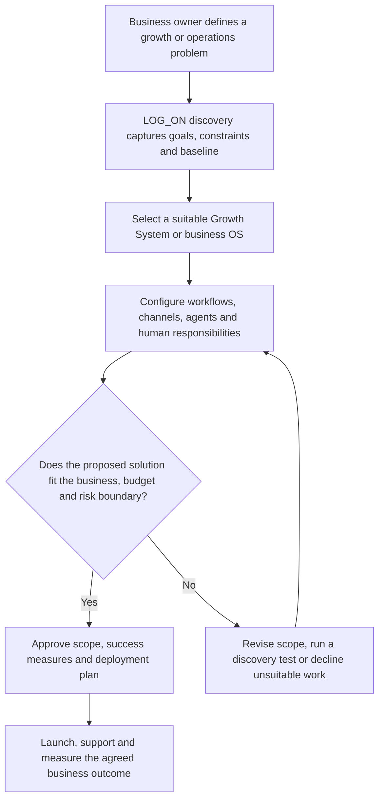

#### Operational flow — system / service workflow

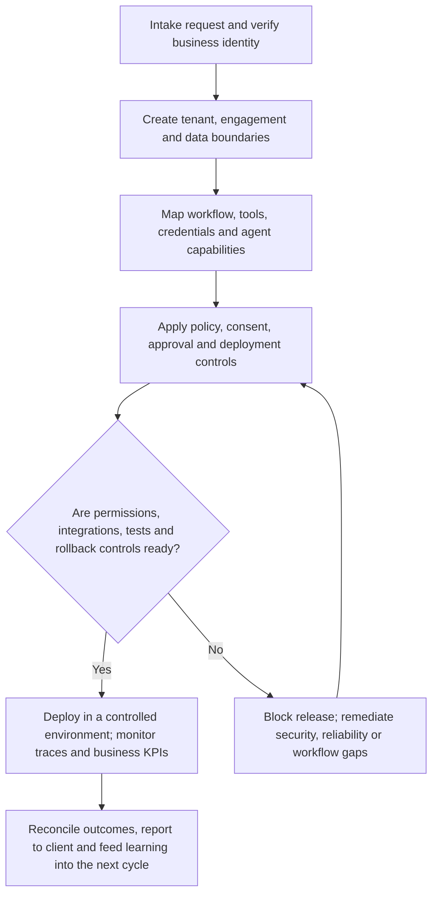

### 2. LOGON Insights Hub

**Classification:** Business intelligence product / module  
**Portfolio status:** Ongoing initiative  
**Purpose:** Turn business, customer, sales and operational data into decision-ready insight.

**Portfolio note:** Treat inferred insights separately from source facts and calculated metrics.

#### Product flow — user / customer / researcher journey

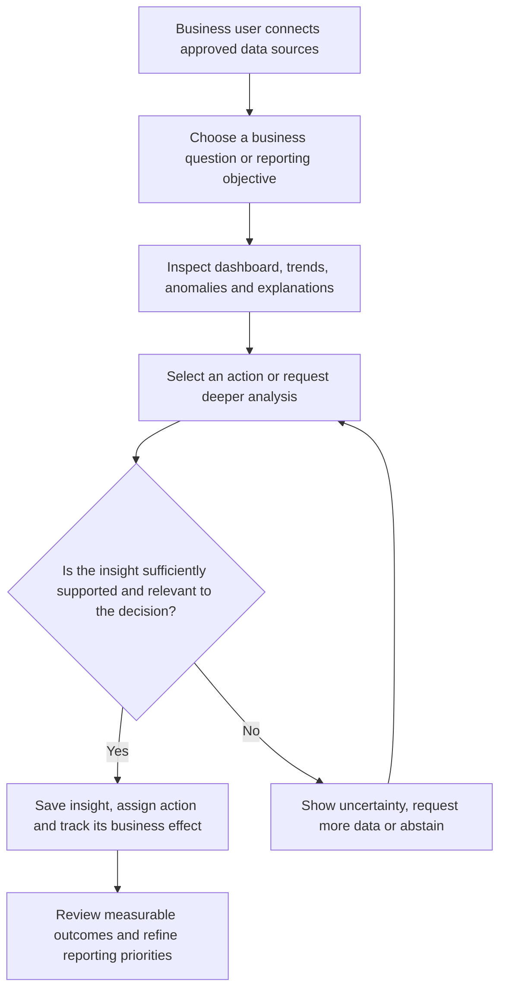

#### Operational flow — system / service workflow

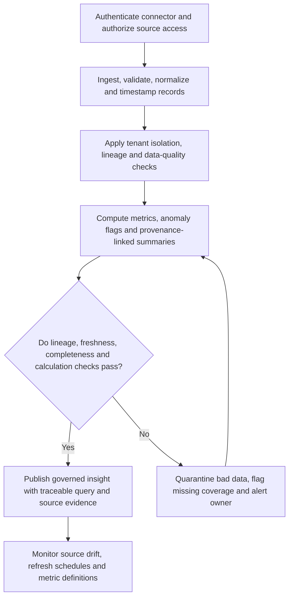

### 3. LOG_ON Reputation Intelligence

**Classification:** Reputation and customer intelligence system  
**Portfolio status:** Ongoing initiative  
**Purpose:** Connect business listings, customer feedback and review journeys to reputation improvement.

**Portfolio note:** Historical concept: GBP → WhatsApp review journeys → dashboard → competitor intelligence → local SEO/sentiment reporting. No fake-review generation.

#### Product flow — user / customer / researcher journey

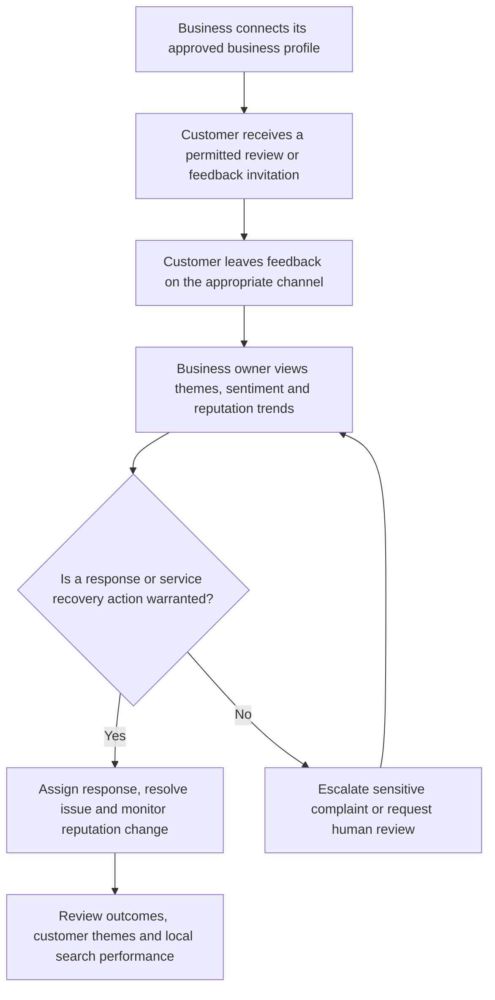

#### Operational flow — system / service workflow

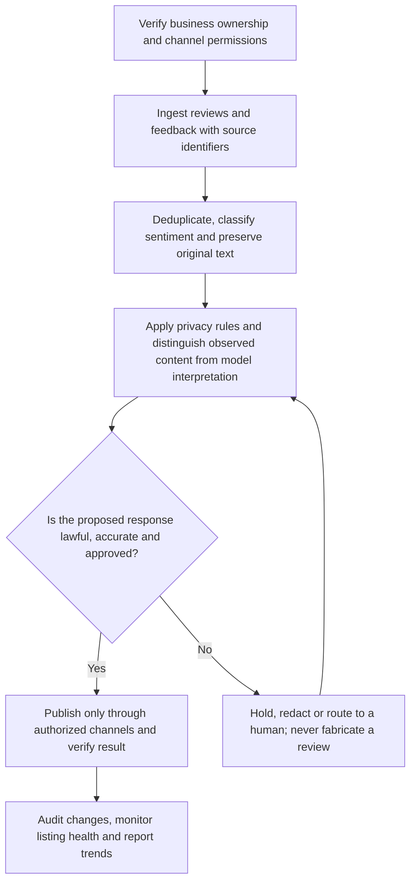

### 4. LOG_ON Growth Systems

**Classification:** Commercial service / reusable business workflows  
**Portfolio status:** Ongoing initiative  
**Purpose:** Improve acquisition, conversion, follow-up, retention and reporting for local businesses.

**Portfolio note:** Includes GEO/local SEO, Google Business Profile, WhatsApp follow-up, review journeys, sales reporting and customer retention.

#### Product flow — user / customer / researcher journey

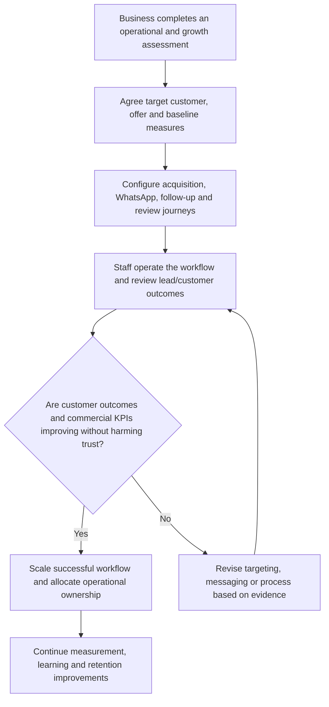

#### Operational flow — system / service workflow

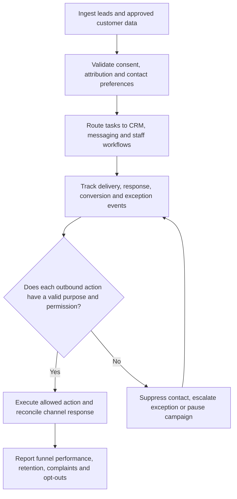

### 5. Hotel / Clinic / Professional / SME OS

**Classification:** Vertical business operating-system family  
**Portfolio status:** Ongoing product family  
**Purpose:** Provide configurable operational workflows for hotels, clinics, professional firms and SMEs.

**Portfolio note:** Treat each vertical as a separately configured deployment; do not assume the clinic, hotel and professional workflows are interchangeable.

#### Product flow — user / customer / researcher journey

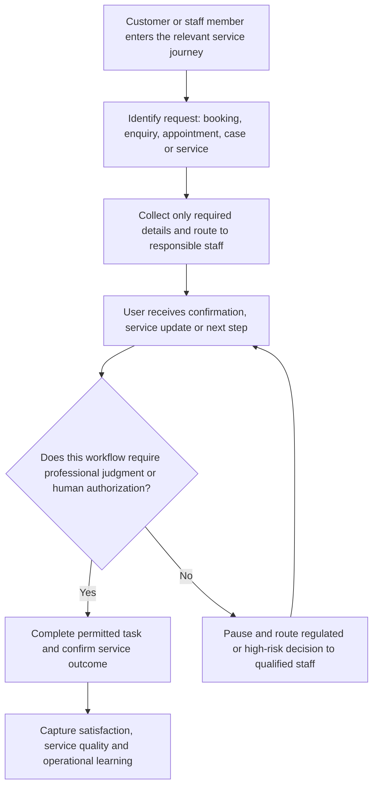

#### Operational flow — system / service workflow

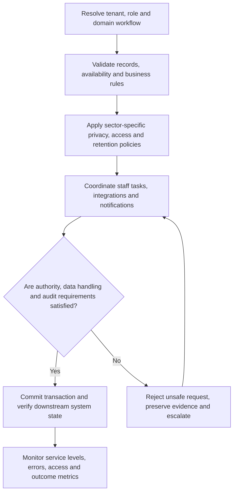

### 6. Opportunity Exploration Engine / Pan-African Opportunity Scanner

**Classification:** Opportunity intelligence product  
**Portfolio status:** Ongoing initiative  
**Purpose:** Discover and evaluate opportunities across African markets, sectors and funding or partnership channels.

**Portfolio note:** Pan-African fields may include Nigeria, Kenya, Ghana, Rwanda, Uganda, Tanzania, South Africa, Egypt, Morocco, Ethiopia, EAC and AfCFTA contexts.

#### Product flow — user / customer / researcher journey

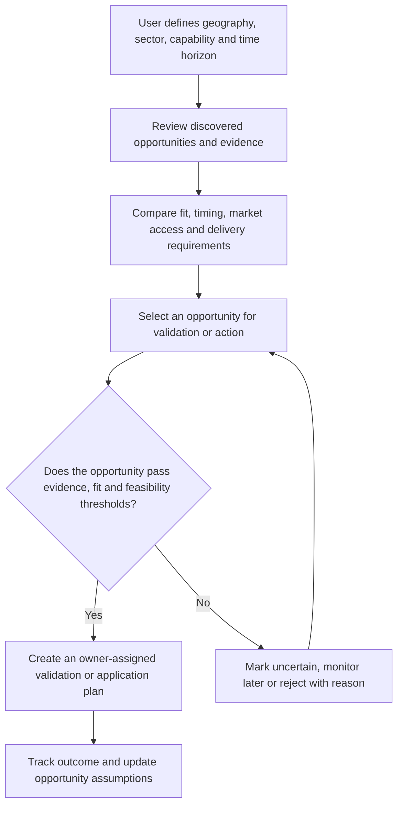

#### Operational flow — system / service workflow

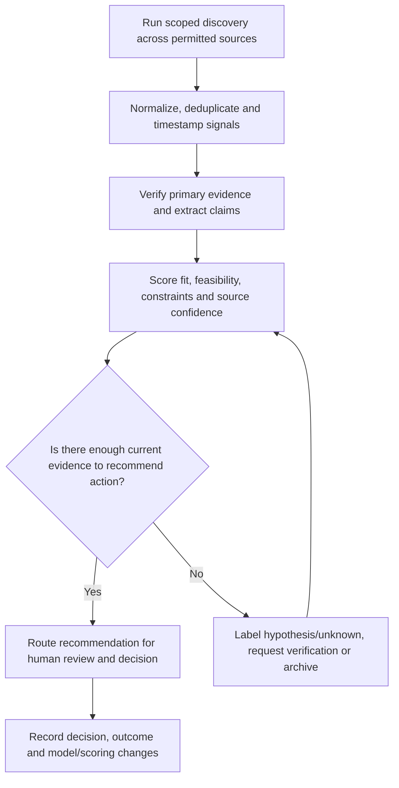

### 7. Global AI Business Intelligence Agent / OpenServ track

**Classification:** Research and agent initiative  
**Portfolio status:** Ongoing initiative; OpenServ integration was planned  
**Purpose:** Coordinate market, company, technology and opportunity intelligence into evidence-backed recommendations.

**Portfolio note:** Keep external agent infrastructure behind explicit contracts; planned integration is not proof of deployed integration.

#### Product flow — user / customer / researcher journey

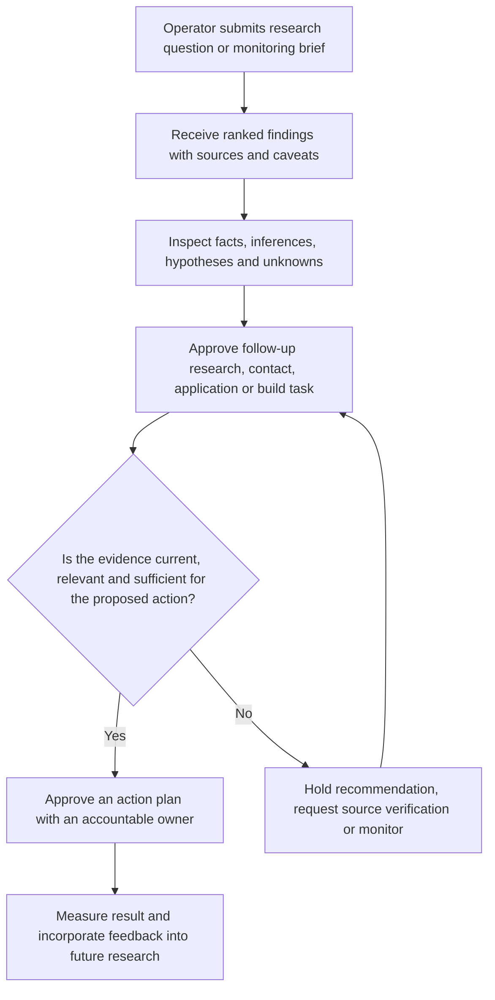

#### Operational flow — system / service workflow

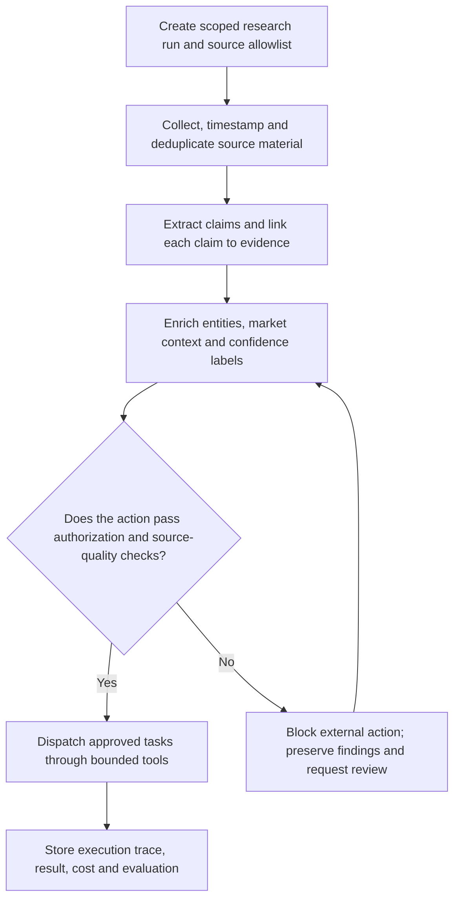

### 8. LOG_ON Agent Assurance

**Classification:** Assurance platform / service  
**Portfolio status:** Ongoing strategic workstream  
**Purpose:** Evaluate whether agents are safe, authorized, observable and recoverable before and after deployment.

**Portfolio note:** Includes Audit-as-Code, Agent Registry, sandboxing, synthetic LOG_ONLY targets, approvals, rollback and supply-chain assurance.

#### Product flow — user / customer / researcher journey

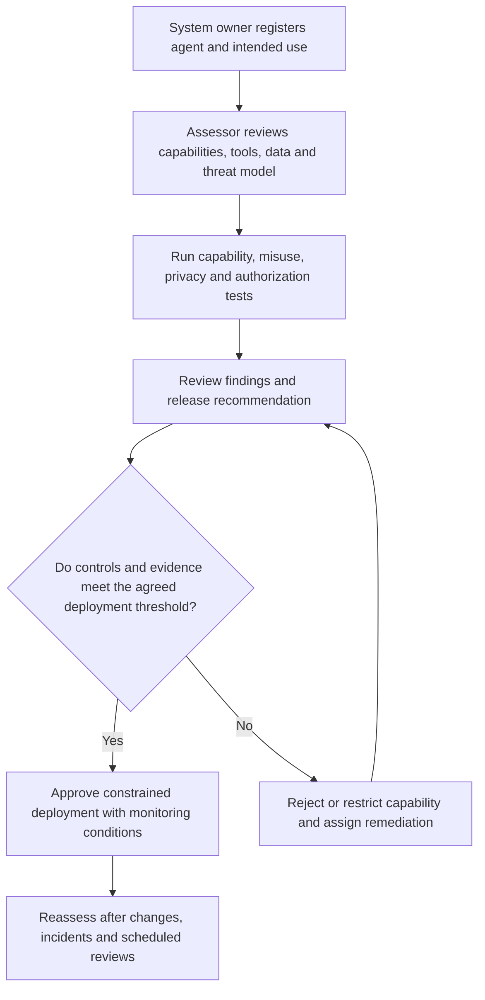

#### Operational flow — system / service workflow

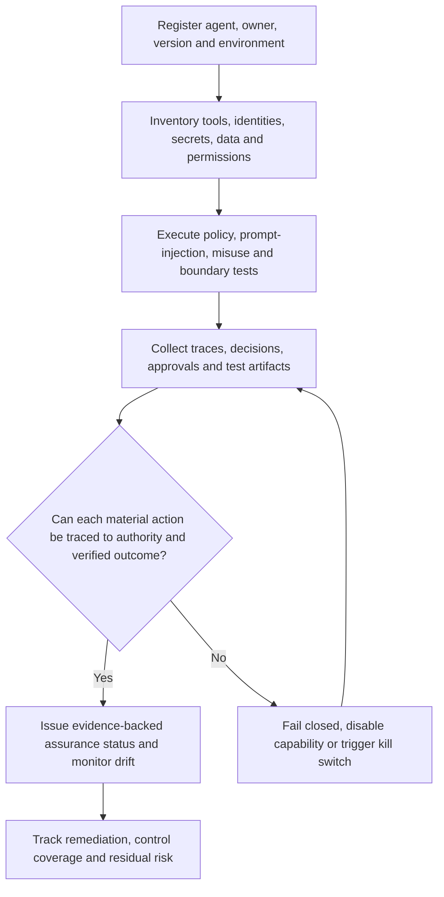

## B. Agent infrastructure and assurance

### 9. AgentBridge-Africa

**Classification:** Agent infrastructure / middleware  
**Portfolio status:** Ongoing project  
**Purpose:** Provide agent execution, capability routing and authorization boundaries for interoperable agents.

**Portfolio note:** Keep agent execution separate from ArchAudit control evaluation and LOG_ON commercial deployment.

#### Product flow — user / customer / researcher journey

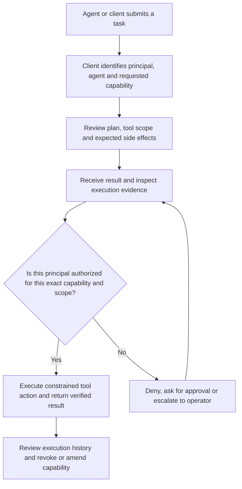

#### Operational flow — system / service workflow

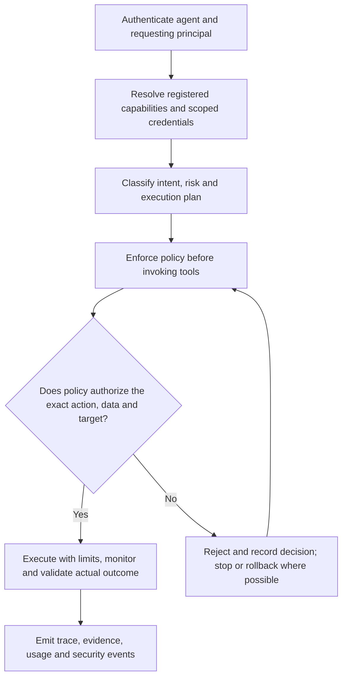

### 10. ArchAudit-CCM

**Classification:** Continuous control monitoring / assurance  
**Portfolio status:** Ongoing project  
**Purpose:** Evaluate controls deterministically and maintain evidence of control status over time.

**Portfolio note:** Avoid converting probabilistic model judgments into deterministic compliance facts.

#### Product flow — user / customer / researcher journey

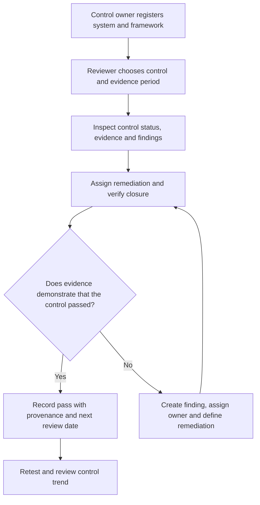

#### Operational flow — system / service workflow

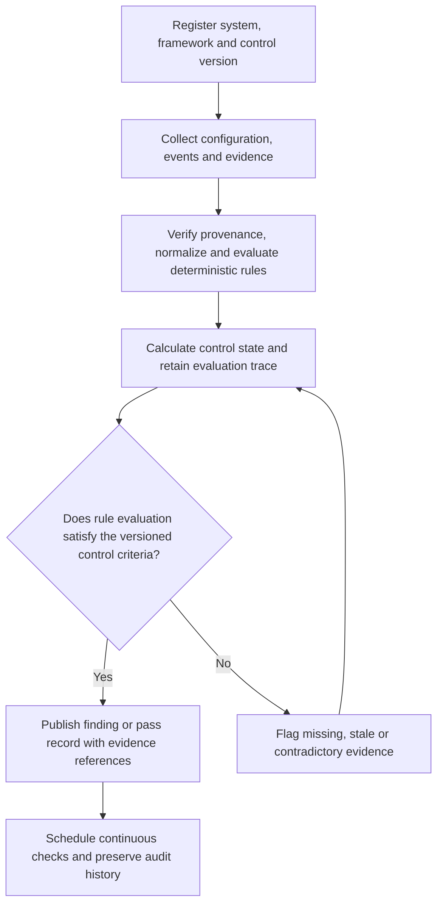

### 11. SafeChain

**Classification:** Blockchain-oriented decision logging and assurance  
**Portfolio status:** Ongoing / historical MVP testnet initiative  
**Purpose:** Record selected decisions and assurance events with tamper-evident references.

**Portfolio note:** A historical Polygon testnet MVP was reported; do not infer current network deployment or production readiness.

#### Product flow — user / customer / researcher journey

```mermaid
flowchart TD
    A["User or system proposes a decision/event to record"]
    B["Review event details and required evidence"]
    C["Confirm policy and intended on-chain/off-chain record"]
    D["Inspect receipt, event history and verification result"]
    E{"Is this event suitable and authorized for ledger recording?"}
    F["Submit minimal authorized record and return receipt"]
    G["Reject or keep off-chain pending review"]
    H["Reconcile transaction status and inspect history"]
    A --> B --> C --> D --> E
    E -->|Yes| F --> H
    E -->|No| G --> D
```

#### Operational flow — system / service workflow

```mermaid
flowchart TD
    A["Validate signer identity and event schema"]
    B["Check duplicate, replay and authorization constraints"]
    C["Minimize sensitive payload; hash or reference approved evidence"]
    D["Submit transaction and monitor confirmation/finality"]
    E{"Is the chain receipt final and consistent with expected event?"}
    F["Verify transaction and reconcile local/chain state"]
    G["Handle failure, reorg, timeout or nonce conflict"]
    H["Retain transaction evidence and operational audit"]
    A --> B --> C --> D --> E
    E -->|Yes| F --> H
    E -->|No| G --> D
```

### 12. GRC Agent Studio

**Classification:** Governance, risk and compliance automation  
**Portfolio status:** Ongoing initiative  
**Purpose:** Help teams map obligations, risks, controls, evidence and remediation workflows.

**Portfolio note:** AI suggestions must not be represented as legal or regulatory determinations without qualified review.

#### Product flow — user / customer / researcher journey

```mermaid
flowchart TD
    A["Organization selects framework and scope"]
    B["Map business processes and assets to obligations"]
    C["Review suggested risks, controls and evidence gaps"]
    D["Assign control owners and remediation work"]
    E{"Has a qualified owner approved the risk/control interpretation?"}
    F["Accept control plan and monitor implementation"]
    G["Mark as draft, disputed or requiring expert review"]
    H["Review residual risk and evidence at reassessment"]
    A --> B --> C --> D --> E
    E -->|Yes| F --> H
    E -->|No| G --> D
```

#### Operational flow — system / service workflow

```mermaid
flowchart TD
    A["Import versioned framework requirements"]
    B["Map entities, processes, risks and controls"]
    C["Collect evidence and evaluate workflow status"]
    D["Route exceptions and remediation with owner and due date"]
    E{"Is evidence sufficient and review authority appropriate?"}
    F["Update control register and generate traceable report"]
    G["Flag unsupported mapping and escalate interpretation"]
    H["Track changes, exceptions, audit logs and framework versions"]
    A --> B --> C --> D --> E
    E -->|Yes| F --> H
    E -->|No| G --> D
```

### 13. Relaywise

**Classification:** Proposed-name product track  
**Portfolio status:** Ongoing design/build track  
**Purpose:** Smart-node identity, context resolution and controlled routing between nodes and services.

**Portfolio note:** Working name retained for the ongoing track; detailed implementation remains subject to repository/specification validation.

#### Product flow — user / customer / researcher journey

```mermaid
flowchart TD
    A["User or connected system emits an event"]
    B["Resolve node, principal and local context"]
    C["Select destination and requested operation"]
    D["Observe approval or routing decision"]
    E{"Is routing and action authority valid?"}
    F["Dispatch to the selected node and return result"]
    G["Reject, request approval or send to operator"]
    H["Review node performance and routing history"]
    A --> B --> C --> D --> E
    E -->|Yes| F --> H
    E -->|No| G --> D
```

#### Operational flow — system / service workflow

```mermaid
flowchart TD
    A["Authenticate event source and node identity"]
    B["Validate payload and node state"]
    C["Resolve route, permissions and approval expiry"]
    D["Dispatch with correlation and idempotency keys"]
    E{"Did the target node execute the authorized operation?"}
    F["Verify response and persist event evidence"]
    G["Retry safely, dead-letter or escalate"]
    H["Monitor node availability, latency and routing failures"]
    A --> B --> C --> D --> E
    E -->|Yes| F --> H
    E -->|No| G --> D
```

### 14. FlowRail

**Classification:** Proposed-name product track  
**Portfolio status:** Ongoing design/build track  
**Purpose:** Durable orchestration of multi-step workflows with checkpoints, retries and recovery.

**Portfolio note:** Working name retained for the ongoing track.

#### Product flow — user / customer / researcher journey

```mermaid
flowchart TD
    A["User configures or triggers a workflow"]
    B["Review steps, dependencies and required permissions"]
    C["Observe progress and approve gated steps"]
    D["Receive completed result or actionable failure state"]
    E{"Can the next step proceed under current state and policy?"}
    F["Continue from durable checkpoint"]
    G["Pause, request approval or route to recovery"]
    H["Inspect run history and resume or cancel"]
    A --> B --> C --> D --> E
    E -->|Yes| F --> H
    E -->|No| G --> D
```

#### Operational flow — system / service workflow

```mermaid
flowchart TD
    A["Create durable workflow instance and version snapshot"]
    B["Validate inputs, preconditions and idempotency"]
    C["Schedule workers and persist step checkpoints"]
    D["Classify exceptions and apply retry/compensation rules"]
    E{"Has the step completed with a verified and persisted result?"}
    F["Advance workflow state and emit completion evidence"]
    G["Back off, dead-letter, compensate or escalate"]
    H["Monitor queues, worker health, retries and stuck runs"]
    A --> B --> C --> D --> E
    E -->|Yes| F --> H
    E -->|No| G --> D
```

### 15. SignalLedger

**Classification:** Proposed-name product track  
**Portfolio status:** Ongoing design/build track  
**Purpose:** Trace events and reconcile expected versus actual system or transaction state.

**Portfolio note:** Working name retained for the ongoing track.

#### Product flow — user / customer / researcher journey

```mermaid
flowchart TD
    A["Operator or service submits event/transaction"]
    B["Search related events and expected state"]
    C["Review matched, unmatched or disputed records"]
    D["Resolve exception and confirm reconciliation"]
    E{"Does observed state reconcile with expected state?"}
    F["Close reconciliation with supporting record"]
    G["Open exception and investigate discrepancy"]
    H["View history, evidence and unresolved exceptions"]
    A --> B --> C --> D --> E
    E -->|Yes| F --> H
    E -->|No| G --> D
```

#### Operational flow — system / service workflow

```mermaid
flowchart TD
    A["Validate source and assign correlation ID"]
    B["Deduplicate and persist event with provenance"]
    C["Correlate event stream and evaluate expected state"]
    D["Detect mismatch, late arrival and replay"]
    E{"Is reconciliation complete and evidence internally consistent?"}
    F["Close with tamper-evident audit trail"]
    G["Create exception workflow and notify owner"]
    H["Track ageing, mismatch rates and correction history"]
    A --> B --> C --> D --> E
    E -->|Yes| F --> H
    E -->|No| G --> D
```

### 16. FoundryKit

**Classification:** Proposed-name product track  
**Portfolio status:** Ongoing design/build track  
**Purpose:** Create repeatable model/product benchmarks and evaluation reports.

**Portfolio note:** Working name retained for the ongoing track.

#### Product flow — user / customer / researcher journey

```mermaid
flowchart TD
    A["Evaluator selects system and evaluation objective"]
    B["Choose dataset, benchmark contract and metrics"]
    C["Run candidate and inspect errors or adversarial cases"]
    D["Compare results and decide readiness"]
    E{"Are results reproducible and acceptance criteria met?"}
    F["Publish evaluation report with limitations"]
    G["Reject candidate or require remediation and retest"]
    H["Track benchmark versions and regression over time"]
    A --> B --> C --> D --> E
    E -->|Yes| F --> H
    E -->|No| G --> D
```

#### Operational flow — system / service workflow

```mermaid
flowchart TD
    A["Version benchmark contract and dataset provenance"]
    B["Check data rights, leakage and contamination"]
    C["Run baseline, candidate and adversarial suite"]
    D["Compute metrics, uncertainty and reproducibility data"]
    E{"Do independent reruns support the reported result?"}
    F["Sign/report result with exact version and environment"]
    G["Quarantine invalid dataset or inconclusive evaluation"]
    H["Store artifacts, run metadata and regression trend"]
    A --> B --> C --> D --> E
    E -->|Yes| F --> H
    E -->|No| G --> D
```

### 17. PatchPilot

**Classification:** Proposed-name product track  
**Portfolio status:** Ongoing design/build track  
**Purpose:** Perform bounded software maintenance with repository inspection, isolated changes and human review.

**Portfolio note:** Working name retained for the ongoing track.

#### Product flow — user / customer / researcher journey

```mermaid
flowchart TD
    A["Developer submits bug or change request"]
    B["Inspect source of truth and affected components"]
    C["Review proposed patch, tests and risk"]
    D["Approve merge or request revision"]
    E{"Do tests and review demonstrate the requested behavior without regressions?"}
    F["Merge through protected workflow and monitor deployment"]
    G["Revise patch, reject or rollback"]
    H["Close change with diff and verification evidence"]
    A --> B --> C --> D --> E
    E -->|Yes| F --> H
    E -->|No| G --> D
```

#### Operational flow — system / service workflow

```mermaid
flowchart TD
    A["Authenticate requester and inspect repository state"]
    B["Create isolated branch/worktree and record base commit"]
    C["Implement bounded changes and run checks"]
    D["Generate diff, tests, security scan and provenance"]
    E{"Are all mandatory CI, security and approval gates satisfied?"}
    F["Merge/release through authorized pipeline"]
    G["Block merge, restore baseline or escalate"]
    H["Monitor deployment and record rollback/incident data"]
    A --> B --> C --> D --> E
    E -->|Yes| F --> H
    E -->|No| G --> D
```

### 18. Cognitive Protocol

**Classification:** Capability assurance / interaction protocol  
**Portfolio status:** Ongoing research/product initiative  
**Purpose:** Introduce capability checks, prediction gates and telemetry into tool-mediated agent interactions.

**Portfolio note:** Historical notes describe a seven-step loop, prediction gates and telemetry; exact canonical protocol should be verified.

#### Product flow — user / customer / researcher journey

```mermaid
flowchart TD
    A["Agent receives task and identifies required capability"]
    B["User or system inspects proposed capability and predicted effect"]
    C["Review evidence and risk before tool use"]
    D["Observe result and correction pathway"]
    E{"Does prediction and policy permit the requested capability?"}
    F["Allow bounded interaction and capture outcome"]
    G["Block, ask for user confirmation or reduce scope"]
    H["Review capability reliability and failure patterns"]
    A --> B --> C --> D --> E
    E -->|Yes| F --> H
    E -->|No| G --> D
```

#### Operational flow — system / service workflow

```mermaid
flowchart TD
    A["Resolve tool manifest and declared capability"]
    B["Compare requested action with policy and expected effect"]
    C["Apply precondition, risk and telemetry gates"]
    D["Record decision, call, result and discrepancy"]
    E{"Did actual execution remain inside the approved capability envelope?"}
    F["Accept trace and update evaluation metrics"]
    G["Stop tool, flag drift and preserve evidence"]
    H["Analyze prediction error and tune tests or policy"]
    A --> B --> C --> D --> E
    E -->|Yes| F --> H
    E -->|No| G --> D
```

### 19. FDE-Platform-2026

**Classification:** Forward-deployed engineering platform initiative  
**Portfolio status:** Ongoing initiative  
**Purpose:** Support repeatable discovery, integration, deployment and operations of customer-specific AI systems.

**Portfolio note:** An initiative/workstream, not necessarily a single standalone SaaS product.

#### Product flow — user / customer / researcher journey

```mermaid
flowchart TD
    A["Customer problem and environment are assessed"]
    B["Agree deployment plan, success metrics and constraints"]
    C["Review prototype/integration in customer context"]
    D["Accept handover and operational ownership"]
    E{"Does the deployed system solve the real workflow under customer conditions?"}
    F["Transition to monitored operation with owner and runbook"]
    G["Return to discovery or redesign integration"]
    H["Track adoption, reliability and measurable business impact"]
    A --> B --> C --> D --> E
    E -->|Yes| F --> H
    E -->|No| G --> D
```

#### Operational flow — system / service workflow

```mermaid
flowchart TD
    A["Inventory customer environment, identities and systems"]
    B["Define tenant boundaries and integration contracts"]
    C["Build and test deployment in controlled environment"]
    D["Release with monitoring, secrets and rollback plan"]
    E{"Are security, acceptance, support and rollback gates complete?"}
    F["Deploy and verify in target environment"]
    G["Block release and document unresolved constraints"]
    H["Monitor incidents, costs, adoption and change requests"]
    A --> B --> C --> D --> E
    E -->|Yes| F --> H
    E -->|No| G --> D
```

## C. Multilingual and cultural intelligence

### 20. PAL — culturally grounded meaning and action platform

**Classification:** Research/product platform  
**Portfolio status:** Ongoing research and product stream  
**Purpose:** Preserve culturally situated meaning across African languages and code-switching, then support contextual and human-approved action.

**Portfolio note:** Keep PAL distinct from Sahara transcription, OMI hardware, and the Meaning-to-Action execution component.

#### Product flow — user / customer / researcher journey

```mermaid
flowchart TD
    A["Contributor or user supplies utterance, text or context"]
    B["Inspect original language, speaker context and intended situation"]
    C["Review retrieved interpretations and supporting sources"]
    D["Choose clarification, explanation or proposed action"]
    E{"Is the interpretation supported, contextually appropriate and safe to act on?"}
    F["Present grounded interpretation or request human-approved action"]
    G["Abstain, show alternatives or request more context"]
    H["Capture correction and evaluate contextual quality"]
    A --> B --> C --> D --> E
    E -->|Yes| F --> H
    E -->|No| G --> D
```

#### Operational flow — system / service workflow

```mermaid
flowchart TD
    A["Ingest source with consent and provenance"]
    B["Preserve original, canonical and search-normalized forms"]
    C["Validate language, diacritics, code-switch spans and annotation"]
    D["Retrieve contextual evidence and assess uncertainty"]
    E{"Does the evidence support a sufficiently reliable interpretation?"}
    F["Generate bounded proposal and route through approval gate"]
    G["Abstain or escalate to linguist/community reviewer"]
    H["Evaluate by language, context, speaker and failure type"]
    A --> B --> C --> D --> E
    E -->|Yes| F --> H
    E -->|No| G --> D
```

### 21. CIE — Contextual Intelligence Exploration

**Classification:** Research framework / PAL-related component  
**Portfolio status:** Ongoing research stream  
**Purpose:** Model how context, relationship, situation and discourse change interpretation.

**Portfolio note:** Related to PAL; retain as a research/component track unless a separate product boundary is defined.

#### Product flow — user / customer / researcher journey

```mermaid
flowchart TD
    A["Researcher selects language sample and situation"]
    B["Annotate participants, relationship, intent and setting"]
    C["Compare interpretations across context variations"]
    D["Inspect contextual explanation and confidence"]
    E{"Does the model explain meaning changes with adequate evidence?"}
    F["Accept annotation/model hypothesis for further evaluation"]
    G["Mark ambiguous, culturally contested or unsupported"]
    H["Add counterexamples and refine contextual representation"]
    A --> B --> C --> D --> E
    E -->|Yes| F --> H
    E -->|No| G --> D
```

#### Operational flow — system / service workflow

```mermaid
flowchart TD
    A["Collect consented examples and metadata"]
    B["Normalize context labels without erasing original text"]
    C["Build contextual feature/representation candidates"]
    D["Evaluate cross-context consistency and disagreement"]
    E{"Does evaluation separate contextual signal from annotator bias?"}
    F["Version accepted representation and dataset"]
    G["Quarantine weak labels and request community review"]
    H["Track disagreement, coverage and regression"]
    A --> B --> C --> D --> E
    E -->|Yes| F --> H
    E -->|No| G --> D
```

### 22. DAPF — Discourse-Adaptive Prompting Framework

**Classification:** Research framework / prompting method  
**Portfolio status:** Ongoing research stream  
**Purpose:** Adapt prompts to discourse structure, intent and conversational context rather than relying on generic prompt templates.

**Portfolio note:** The prior context says DAPF replaced the older Proverb-Logic terminology; verify exact expansion from canonical research docs.

#### Product flow — user / customer / researcher journey

```mermaid
flowchart TD    A["User/task provides discourse and desired outcome"]
    B["Identify discourse type, intent and context constraints"]
    C["Select or compose an adapted prompt strategy"]
    D["Review output against the original communicative purpose"]
    E{"Does adaptation improve task performance without distorting intent?"}
    F["Use prompt and record evaluation result"]
    G["Fall back to neutral prompt or request clarification"]
    H["Compare results across contexts and revise framework"]
    A --> B --> C --> D --> E
    E -->|Yes| F --> H
    E -->|No| G --> D
```

#### Operational flow — system / service workflow

```mermaid
flowchart TD
    A["Parse input and label discourse features"]
    B["Select versioned prompt policy and model configuration"]
    C["Execute under bounded context and output constraints"]
    D["Evaluate quality, drift, fairness and failure cases"]
    E{"Does the adaptive prompt meet predefined benchmark criteria?"}
    F["Retain reproducible prompt/run artifacts"]
    G["Reject adaptation and preserve baseline behavior"]
    H["Track prompt versions, regressions and domain coverage"]
    A --> B --> C --> D --> E
    E -->|Yes| F --> H
    E -->|No| G --> D
```

### 23. Proverb Activation Library

**Classification:** Legacy / related PAL research asset  
**Portfolio status:** Historical / folded into PAL-related research  
**Purpose:** Historical proverb- and culturally grounded activation/representation work associated with the earlier PAL concept.

**Portfolio note:** Do not treat historical name as the current canonical PAL expansion without checking the source specification.

#### Product flow — user / customer / researcher journey

```mermaid
flowchart TD
    A["Researcher or user searches proverb or expression"]
    B["Inspect original wording, language and source context"]
    C["Compare possible meanings and usage situations"]
    D["Use only a cited interpretation appropriate to the context"]
    E{"Is the phrase sourced and contextually validated?"}
    F["Retain with attribution and qualified interpretation"]
    G["Mark unknown, disputed or culturally variable"]
    H["Feed validated examples into PAL research evaluation"]
    A --> B --> C --> D --> E
    E -->|Yes| F --> H
    E -->|No| G --> D
```

#### Operational flow — system / service workflow

```mermaid
flowchart TD
    A["Register source and collection provenance"]
    B["Preserve original script, diacritics and variants"]
    C["Annotate context and community review"]
    D["Version and evaluate retrieval/interpretation"]
    E{"Can every interpretation be traced to a source and reviewer?"}
    F["Retain evidence-linked entry"]
    G["Quarantine unsupported or conflicting entry"]
    H["Audit corpus coverage and corrections"]
    A --> B --> C --> D --> E
    E -->|Yes| F --> H
    E -->|No| G --> D
```

### 24. Sahara CodeSwitch

**Classification:** Speech/language research and service track  
**Portfolio status:** Ongoing research initiative  
**Purpose:** Handle multilingual and code-switched African speech, including English, Nigerian Pidgin and Yoruba contexts.

**Portfolio note:** Do not invent a corpus or report benchmark performance without real data and reproducible evaluation.

#### Product flow — user / customer / researcher journey

```mermaid
flowchart TD
    A["Speaker provides consented audio sample"]
    B["Inspect transcript and code-switch segments"]
    C["Review language-specific uncertainty and corrections"]
    D["Use transcript in a downstream task or evaluation"]
    E{"Is transcription quality adequate for the intended downstream use?"}
    F["Return transcript with language spans and uncertainty"]
    G["Ask for replay, human correction or abstain"]
    H["Capture correction for evaluation where permitted"]
    A --> B --> C --> D --> E
    E -->|Yes| F --> H
    E -->|No| G --> D
```

#### Operational flow — system / service workflow

```mermaid
flowchart TD
    A["Receive audio with consent and metadata"]
    B["Preprocess signal and detect language/code-switch spans"]
    C["Run ASR and align text/timestamps"]
    D["Evaluate WER/CER and context-specific errors"]
    E{"Do quality and confidence thresholds meet task requirements?"}
    F["Publish versioned transcript and evaluation record"]
    G["Flag low-confidence segments for review"]
    H["Track language coverage, drift and error classes"]
    A --> B --> C --> D --> E
    E -->|Yes| F --> H
    E -->|No| G --> D
```

### 25. wwhisper

**Classification:** Speech/transcription research repository  
**Portfolio status:** Ongoing research project  
**Purpose:** Explore transcription pipelines and multilingual/codeswitch speech handling, including integrations discussed with AssemblyAI.

**Portfolio note:** Keep wwhisper separate from PAL: it is a transcription/research implementation track.

#### Product flow — user / customer / researcher journey

```mermaid
flowchart TD
    A["Developer or researcher submits audio sample"]
    B["Choose transcription backend and language conditions"]
    C["Inspect transcript, timestamps and segmentation"]
    D["Compare transcript quality across test cases"]
    E{"Does the backend meet accuracy, latency and cost requirements?"}
    F["Select backend/configuration for the use case"]
    G["Fallback to alternate backend or human transcription"]
    H["Publish comparison and regression findings"]
    A --> B --> C --> D --> E
    E -->|Yes| F --> H
    E -->|No| G --> D
```

#### Operational flow — system / service workflow

```mermaid
flowchart TD
    A["Validate audio format, rights and consent"]
    B["Run adapter/backend with recorded configuration"]
    C["Normalize outputs and align timestamps"]
    D["Evaluate against labeled reference and error taxonomy"]
    E{"Are results reproducible and within acceptance limits?"}
    F["Store run metadata and comparison artifacts"]
    G["Reject ungrounded score or incomplete test"]
    H["Track provider changes, latency, cost and error drift"]
    A --> B --> C --> D --> E
    E -->|Yes| F --> H
    E -->|No| G --> D
```

### 26. OMI Edge Ear

**Classification:** Edge voice device / interface concept  
**Portfolio status:** Ongoing concept and architecture track  
**Purpose:** Capture nearby speech through an edge interface and route permitted voice interactions to the PAL action pipeline.

**Portfolio note:** Previously described path: BLE/Wi-Fi → PAL Mobile Gateway → Sahara STT → Meaning-to-Action Kernel → Composer’s Voice Twin.

#### Product flow — user / customer / researcher journey

```mermaid
flowchart TD
    A["User activates device and sees/listens for recording state"]
    B["Device captures a permitted voice input"]
    C["User reviews detected transcript or intent"]
    D["User confirms a proposed downstream action"]
    E{"Does the user approve the action and is the action authorized?"}
    F["Send approved request to the action interface"]
    G["Cancel, request clarification or discard audio"]
    H["Show execution feedback and session controls"]
    A --> B --> C --> D --> E
    E -->|Yes| F --> H
    E -->|No| G --> D
```

#### Operational flow — system / service workflow

```mermaid
flowchart TD
    A["Establish BLE/Wi-Fi connection and device identity"]
    B["Check consent, capture state and audio retention policy"]
    C["Send audio to PAL Mobile Gateway / STT route"]
    D["Pass confidence, context and action proposal to policy gate"]
    E{"Is device session valid and action within authorized scope?"}
    F["Execute only approved action and verify downstream result"]
    G["Stop capture, reject replay or escalate uncertainty"]
    H["Record minimal audit metadata and enforce deletion/retention"]
    A --> B --> C --> D --> E
    E -->|Yes| F --> H
    E -->|No| G --> D
```

### 27. Meaning-to-Action Kernel 2.1

**Classification:** Action interpretation and policy component  
**Portfolio status:** Ongoing component initiative  
**Purpose:** Convert interpreted meaning into a structured, policy-checked action proposal.

**Portfolio note:** Component of voice-to-action architecture, not a standalone speech recognizer.

#### Product flow — user / customer / researcher journey

```mermaid
flowchart TD
    A["Receive interpreted utterance and task context"]
    B["Review candidate intent and entities"]
    C["Inspect proposed action, target and consequences"]
    D["Approve, edit or reject proposal"]
    E{"Does the action match intent and satisfy policy/consent?"}
    F["Submit authorized action to execution service"]
    G["Ask for clarification or refuse unsafe action"]
    H["Return outcome and correction to the interpretation loop"]
    A --> B --> C --> D --> E
    E -->|Yes| F --> H
    E -->|No| G --> D
```

#### Operational flow — system / service workflow

```mermaid
flowchart TD
    A["Validate MeaningState schema and provenance"]
    B["Resolve entities, context and action parameters"]
    C["Check risk, capability, authority and confirmation requirements"]
    D["Produce signed or traceable ActionPlan"]
    E{"Is the ActionPlan complete, authorized and bound to the correct principal?"}
    F["Dispatch through constrained execution interface"]
    G["Reject plan and preserve reason/evidence"]
    H["Verify result and record decision/action linkage"]
    A --> B --> C --> D --> E
    E -->|Yes| F --> H
    E -->|No| G --> D
```

### 28. Composer’s Voice Twin

**Classification:** Voice representation / interaction component  
**Portfolio status:** Ongoing concept  
**Purpose:** Provide a controlled voice representation or response style for a principal, with consent and provenance boundaries.

**Portfolio note:** Do not assume voice cloning, identity verification or biometric capabilities without explicit validated specifications.

#### Product flow — user / customer / researcher journey

```mermaid
flowchart TD
    A["Principal configures voice representation and preferences"]
    B["Review sample response and disclosures"]
    C["Approve a permitted use or response context"]
    D["Revoke, change or suspend voice use"]
    E{"Is the use authorized for this principal, context and audience?"}
    F["Generate permitted response with appropriate disclosure"]
    G["Deny use or require renewed consent"]
    H["Review voice activity and control settings"]
    A --> B --> C --> D --> E
    E -->|Yes| F --> H
    E -->|No| G --> D
```

#### Operational flow — system / service workflow

```mermaid
flowchart TD
    A["Register voice asset and principal authority"]
    B["Verify consent, allowed contexts and revocation state"]
    C["Generate output using scoped model/asset controls"]
    D["Apply disclosure, watermarking or provenance rules as required"]
    E{"Is generation within the authorized voice scope?"}
    F["Deliver output and record minimal audit evidence"]
    G["Block, revoke or quarantine output"]
    H["Monitor misuse, revocation and retention compliance"]
    A --> B --> C --> D --> E
    E -->|Yes| F --> H
    E -->|No| G --> D
```

### 29. Voice / STT Adapters

**Classification:** Reusable integration component family  
**Portfolio status:** Ongoing component initiative  
**Purpose:** Normalize speech provider interfaces and transcript outputs for downstream products.

**Portfolio note:** Component family; not one standalone end-user product.

#### Product flow — user / customer / researcher journey

```mermaid
flowchart TD
    A["Product selects audio input and language requirements"]
    B["Choose supported speech adapter"]
    C["Inspect transcript and confidence metadata"]
    D["Use result or request correction"]
    E{"Does the chosen adapter support the language, format and use case?"}
    F["Return normalized transcript contract"]
    G["Fallback, degrade gracefully or request human review"]
    H["Feed defects into adapter selection and tests"]
    A --> B --> C --> D --> E
    E -->|Yes| F --> H
    E -->|No| G --> D
```

#### Operational flow — system / service workflow

```mermaid
flowchart TD
    A["Validate input media, consent and provider configuration"]
    B["Call provider through adapter interface"]
    C["Normalize timestamps, speakers, language and confidence"]
    D["Apply timeout, retry, redaction and provider error mapping"]
    E{"Is provider response valid and within latency/quality limits?"}
    F["Emit normalized event and trace"]
    G["Retry safely or return typed failure"]
    H["Monitor cost, availability, version and quality drift"]
    A --> B --> C --> D --> E
    E -->|Yes| F --> H
    E -->|No| G --> D
```

### 30. Cultural Compression

**Classification:** Research concept / evaluation topic  
**Portfolio status:** Ongoing research question  
**Purpose:** Study how cultural context is compressed, lost or distorted when meaning is represented across languages or model interfaces.

**Portfolio note:** Research construct, not a validated product capability by itself.

#### Product flow — user / customer / researcher journey

```mermaid
flowchart TD
    A["Researcher selects source expression and target representation"]
    B["Compare original, compressed and reconstructed meanings"]
    C["Inspect missing context and shifted pragmatic implications"]
    D["Record limitations and counterexamples"]
    E{"Can the transformation preserve the meaning dimensions required by the task?"}
    F["Accept bounded representation with documented loss"]
    G["Reject or label irreducible/context-dependent loss"]
    H["Add cases to research benchmark"]
    A --> B --> C --> D --> E
    E -->|Yes| F --> H
    E -->|No| G --> D
```

#### Operational flow — system / service workflow

```mermaid
flowchart TD
    A["Define operational dimensions of cultural information"]
    B["Collect sourced examples and contextual annotations"]
    C["Measure representation loss and disagreement"]
    D["Run cross-language and cross-context tests"]
    E{"Are measures valid, reproducible and culturally reviewed?"}
    F["Publish qualified findings and test artifacts"]
    G["Mark construct invalid or evidence insufficient"]
    H["Maintain dataset provenance and review record"]
    A --> B --> C --> D --> E
    E -->|Yes| F --> H
    E -->|No| G --> D
```

### 31. Epistemic Translation Loss

**Classification:** Research concept / evaluation topic  
**Portfolio status:** Ongoing research question  
**Purpose:** Study what uncertainty, authority, nuance or evidential status is lost when knowledge is translated between languages or systems.

**Portfolio note:** Research topic; not an independently validated production service.

#### Product flow — user / customer / researcher journey

```mermaid
flowchart TD
    A["Researcher selects source claim and translation task"]
    B["Compare original and translated statements"]
    C["Inspect changes in certainty, attribution and scope"]
    D["Record ambiguity and translation alternatives"]
    E{"Has evidential status or meaning materially changed?"}
    F["Retain translation with explicit uncertainty note"]
    G["Escalate to bilingual expert or preserve alternatives"]
    H["Add failure case to evaluation set"]
    A --> B --> C --> D --> E
    E -->|Yes| F --> H
    E -->|No| G --> D
```

#### Operational flow — system / service workflow

```mermaid
flowchart TD
    A["Capture source and translation provenance"]
    B["Annotate certainty, attribution, modality and scope"]
    C["Measure semantic/evidential changes"]
    D["Validate with bilingual reviewers and counterexamples"]
    E{"Can loss be reliably distinguished from acceptable paraphrase?"}
    F["Version method and results"]
    G["Report inconclusive construct or annotator disagreement"]
    H["Track reproducibility and reviewer agreement"]
    A --> B --> C --> D --> E
    E -->|Yes| F --> H
    E -->|No| G --> D
```

### 32. Salience-Weighted Recall

**Classification:** Memory retrieval research component  
**Portfolio status:** Ongoing research initiative  
**Purpose:** Explore memory ranking that accounts for salience, recency, relevance and user-defined importance.

**Portfolio note:** Research component; ensure user control and data minimization.

#### Product flow — user / customer / researcher journey

```mermaid
flowchart TD
    A["User asks a question or requests past context"]
    B["Inspect retrieved memories and why they were selected"]
    C["Correct priority or mark information as important/obsolete"]
    D["Use recalled material in current task"]
    E{"Does retrieval reflect relevance without over-weighting sensitive or stale data?"}
    F["Use bounded, evidence-linked recall"]
    G["Ask clarification or omit uncertain memory"]
    H["Capture explicit feedback and user controls"]
    A --> B --> C --> D --> E
    E -->|Yes| F --> H
    E -->|No| G --> D
```

#### Operational flow — system / service workflow

```mermaid
flowchart TD
    A["Resolve authorized memory scope"]
    B["Generate candidate retrieval set"]
    C["Score relevance, salience, recency and provenance"]
    D["Apply privacy, conflict and expiry filters"]
    E{"Does ranked set satisfy policy and retrieval-quality tests?"}
    F["Return cited/contextualized results"]
    G["Suppress stale, sensitive or conflicting records"]
    H["Evaluate ranking, deletion and bias across query types"]
    A --> B --> C --> D --> E
    E -->|Yes| F --> H
    E -->|No| G --> D
```

### 33. Discourse-Native Benchmarks

**Classification:** Evaluation research / benchmark family  
**Portfolio status:** Ongoing research initiative  
**Purpose:** Evaluate language systems on real discourse, pragmatic meaning and context rather than isolated sentence tasks alone.

**Portfolio note:** Avoid claiming performance from unvalidated or fabricated corpus data.

#### Product flow — user / customer / researcher journey

```mermaid
flowchart TD
    A["Evaluator chooses task, discourse setting and language"]
    B["Inspect test dialogue and contextual assumptions"]
    C["Compare model outputs and human judgments"]
    D["Review failure classes and benchmark limitations"]
    E{"Does the benchmark measure the intended real-world capability?"}
    F["Use results with documented scope and limitations"]
    G["Reject contaminated or construct-invalid benchmark"]
    H["Add validated cases and update benchmark version"]
    A --> B --> C --> D --> E
    E -->|Yes| F --> H
    E -->|No| G --> D
```

#### Operational flow — system / service workflow

```mermaid
flowchart TD
    A["Define construct and evaluation protocol"]
    B["Collect consented, sourced discourse examples"]
    C["Annotate with reviewer disagreement and provenance"]
    D["Run model/human baselines and statistical analysis"]
    E{"Are dataset quality, leakage, reliability and validity acceptable?"}
    F["Publish reproducible benchmark package"]
    G["Quarantine invalid items and report limitations"]
    H["Monitor benchmark drift and version changes"]
    A --> B --> C --> D --> E
    E -->|Yes| F --> H
    E -->|No| G --> D
```

### 34. African Cognitive AI Programme

**Classification:** Research programme  
**Portfolio status:** Ongoing programme  
**Purpose:** Coordinate research on African language, discourse, cognition, cultural context and human-AI interaction.

**Portfolio note:** Programme umbrella; PAL, CIE, DAPF and related work may sit beneath it without being merged into one product.

#### Product flow — user / customer / researcher journey

```mermaid
flowchart TD
    A["Researcher or community partner proposes research question"]
    B["Agree scope, collaborators, ethics and intended impact"]
    C["Review findings, datasets and prototype demonstrations"]
    D["Decide whether to publish, extend or translate into a product"]
    E{"Are methods, evidence, community involvement and ethics sufficient?"}
    F["Approve next research phase or dissemination"]
    G["Pause, revise methodology or seek review"]
    H["Track research outputs and community feedback"]
    A --> B --> C --> D --> E
    E -->|Yes| F --> H
    E -->|No| G --> D
```

#### Operational flow — system / service workflow

```mermaid
flowchart TD
    A["Register project, question, ownership and ethics status"]
    B["Define data governance and participant consent"]
    C["Run studies, annotation and reproducible analysis"]
    D["Review claims, limitations and artifacts"]
    E{"Does the work meet research integrity and data-governance requirements?"}
    F["Release approved outputs with provenance"]
    G["Restrict, correct or withdraw unsupported findings"]
    H["Maintain versioned record of datasets, papers and decisions"]
    A --> B --> C --> D --> E
    E -->|Yes| F --> H
    E -->|No| G --> D
```

## D. Context, memory and productivity

### 35. ContextPocket

**Classification:** Agent memory infrastructure  
**Portfolio status:** Ongoing project  
**Purpose:** Capture, organize, retrieve and govern agent context through isolated, permissioned memory operations.

**Portfolio note:** Historical status: MCP capture/search with Bearer auth was reported; OAuth background sync and some template tests were incomplete at that snapshot.

#### Product flow — user / customer / researcher journey

```mermaid
flowchart TD
    A["User or agent submits context"]
    B["Review memory category and storage choice"]
    C["Ask a future question or request relevant context"]
    D["Inspect returned source references and manage retention"]
    E{"Is storage permitted and is retrieved context appropriate to disclose?"}
    F["Store or return context within authorized scope"]
    G["Keep ephemeral, deny, redact or request clarification"]
    H["Update, expire or delete memory under user control"]
    A --> B --> C --> D --> E
    E -->|Yes| F --> H
    E -->|No| G --> D
```

#### Operational flow — system / service workflow

```mermaid
flowchart TD
    A["Authenticate user/agent and tenant"]
    B["Validate schema, consent and retention policy"]
    C["Normalize and persist context with provenance"]
    D["Retrieve using scoped search and injection controls"]
    E{"Do isolation, access, provenance and lifecycle checks pass?"}
    F["Return bounded context and audit metadata"]
    G["Reject access, isolate corrupt data or execute deletion workflow"]
    H["Monitor indexing, sync, migrations, backups and security tests"]
    A --> B --> C --> D --> E
    E -->|Yes| F --> H
    E -->|No| G --> D
```

### 36. RecallGrid

**Classification:** Proposed-name product track  
**Portfolio status:** Ongoing design/build track  
**Purpose:** A mesh of permissioned memory sources with provenance-aware retrieval and conflict handling.

**Portfolio note:** Proposed name for a memory-mesh track; keep separate from ContextPocket unless a deliberate integration is specified.

#### Product flow — user / customer / researcher journey

```mermaid
flowchart TD
    A["User asks across connected memory sources"]
    B["Choose scope and inspect which sources can be queried"]
    C["Review ranked, conflict-aware memories"]
    D["Use, correct or suppress returned context"]
    E{"Does each candidate belong to the user and authorized scope?"}
    F["Return evidence-linked context from allowed nodes"]
    G["Exclude unauthorized, stale or disputed items"]
    H["Update memory links and user preferences"]
    A --> B --> C --> D --> E
    E -->|Yes| F --> H
    E -->|No| G --> D
```

#### Operational flow — system / service workflow

```mermaid
flowchart TD
    A["Resolve principal, tenant and source permissions"]
    B["Query authorized memory nodes"]
    C["Normalize, deduplicate and check freshness"]
    D["Resolve conflict visibility and construct context packet"]
    E{"Are source ownership, deletion and permission constraints satisfied?"}
    F["Return context with provenance map"]
    G["Suppress conflicting or unauthorized data"]
    H["Propagate expiry/deletion and monitor node consistency"]
    A --> B --> C --> D --> E
    E -->|Yes| F --> H
    E -->|No| G --> D
```

### 37. Re:Mind Me

**Classification:** Personal memory and reminder PWA  
**Portfolio status:** Ongoing project  
**Purpose:** Capture daily work, commitments and voice notes across AI conversations and personal workflows, then retrieve and remind.

**Portfolio note:** Historical architecture: Supabase DB, MCP capture/search and Bearer auth; OAuth background sync was not yet built in the earlier snapshot. Includes Thinking Orb / Slumber concepts.

#### Product flow — user / customer / researcher journey

```mermaid
flowchart TD
    A["User captures chat, voice note or manual entry"]
    B["Review extracted tasks, commitments and dates"]
    C["Confirm reminder and preferred delivery channel"]
    D["Receive reminder and complete, reschedule or archive"]
    E{"Are task meaning, date, timezone and reminder destination correct?"}
    F["Save confirmed commitment and schedule reminder"]
    G["Ask clarification, keep unscheduled or discard"]
    H["Track completion and surface relevant history"]
    A --> B --> C --> D --> E
    E -->|Yes| F --> H
    E -->|No| G --> D
```

#### Operational flow — system / service workflow

```mermaid
flowchart TD
    A["Authenticate source and ingest capture"]
    B["Extract structured tasks and commitments"]
    C["Normalize dates/timezones and resolve ambiguity"]
    D["Persist in Supabase and index for retrieval"]
    E{"Is the record valid, authorized and schedulable?"}
    F["Schedule and deliver reminder; record acknowledgement"]
    G["Retry delivery, flag ambiguity or dead-letter failure"]
    H["Reconcile scheduler, completion state and retention"]
    A --> B --> C --> D --> E
    E -->|Yes| F --> H
    E -->|No| G --> D
```

### 38. Canonpath

**Classification:** Proposed-name product track  
**Portfolio status:** Ongoing design/build track  
**Purpose:** Canonical document workflows with provenance, review, versioning and controlled publishing.

**Portfolio note:** Proposed-name product track; document lifecycle needs repo/spec verification.

#### Product flow — user / customer / researcher journey

```mermaid
flowchart TD
    A["User uploads or creates a document"]
    B["Inspect extracted structure and canonical version"]
    C["Collaborate, review and approve changes"]
    D["Export, publish or archive approved document"]
    E{"Is the current version approved by the correct authority?"}
    F["Publish immutable version and share authorized output"]
    G["Return for revision or block unauthorized release"]
    H["Track document lineage and future amendments"]
    A --> B --> C --> D --> E
    E -->|Yes| F --> H
    E -->|No| G --> D
```

#### Operational flow — system / service workflow

```mermaid
flowchart TD
    A["Validate file, content and access scope"]
    B["Parse and create canonical representation"]
    C["Version content and attach source metadata"]
    D["Enforce approval and export permissions"]
    E{"Does the artifact match approved content and integrity hash?"}
    F["Release export and record audit event"]
    G["Quarantine malformed or unauthorized artifact"]
    H["Manage retention, version history and recovery"]
    A --> B --> C --> D --> E
    E -->|Yes| F --> H
    E -->|No| G --> D
```

## E. Consent and voice interaction

### 39. MorrowVoice

**Classification:** Consent-centred voice assistant  
**Portfolio status:** Ongoing project  
**Purpose:** Compose a principal-controlled voice interaction surface with deterministic consent kernels and auditable authority.

**Portfolio note:** Invariants: default deny; retention off by default; sharing off by default; consent kernel is authority, not UI; adult authority is not blanket operator access.

#### Product flow — user / customer / researcher journey

```mermaid
flowchart TD
    A["Principal initiates voice interaction"]
    B["Review active consent and requested capability"]
    C["Choose scope, retention and sharing preferences"]
    D["Receive response or approve a permitted operation"]
    E{"Is consent current, specific, scoped and revocable for this operation?"}
    F["Proceed with explicitly permitted operation"]
    G["Deny and explain; do not infer permission from operator status"]
    H["Return control to principal and expose audit/consent controls"]
    A --> B --> C --> D --> E
    E -->|Yes| F --> H
    E -->|No| G --> D
```

#### Operational flow — system / service workflow

```mermaid
flowchart TD
    A["Identify principal and load consent state"]
    B["Evaluate deterministic consent kernel"]
    C["Check capability scope, revocation and data policy"]
    D["Execute only authorized operation and write audit evidence"]
    E{"Does kernel authorize this exact action and data flow?"}
    F["Verify result and apply retention/sharing settings"]
    G["Fail closed and record denial"]
    H["Monitor revocation, consent changes and audit integrity"]
    A --> B --> C --> D --> E
    E -->|Yes| F --> H
    E -->|No| G --> D
```

### 40. SpeakBridge

**Classification:** Proposed-name product track  
**Portfolio status:** Ongoing design/build track  
**Purpose:** Manage voice sessions, devices, consent, transcription and approved responses across products.

**Portfolio note:** Proposed-name voice management track; MorrowVoice remains the separate consent-principal system.

#### Product flow — user / customer / researcher journey

```mermaid
flowchart TD
    A["User opens voice session"]
    B["Review identity, device and recording state"]
    C["Speak and inspect transcription or proposed action"]
    D["Confirm response/action and close session"]
    E{"Are session consent and action permissions valid?"}
    F["Respond or execute permitted operation"]
    G["Stop capture, deny or ask for clarification"]
    H["Close session and manage saved artifacts"]
    A --> B --> C --> D --> E
    E -->|Yes| F --> H
    E -->|No| G --> D
```

#### Operational flow — system / service workflow

```mermaid
flowchart TD
    A["Authenticate device and principal"]
    B["Establish consented session and capture policy"]
    C["Transcribe and resolve intent/context"]
    D["Route through capability and approval checks"]
    E{"Is the action authorized and session still valid?"}
    F["Execute, verify and record bounded evidence"]
    G["Terminate session and apply retention/deletion"]
    H["Audit recording, permission and provider events"]
    A --> B --> C --> D --> E
    E -->|Yes| F --> H
    E -->|No| G --> D
```

## F. Evidence and entity intelligence

### 41. GroundedGuide

**Classification:** Evidence-grounded guidance product  
**Portfolio status:** Ongoing project  
**Purpose:** Answer user questions from verifiable sources while exposing uncertainty and abstaining when evidence is insufficient.

**Portfolio note:** Public positioning must not reveal Knowster as the source reference; product identity should stand on its own.

#### Product flow — user / customer / researcher journey

```mermaid
flowchart TD
    A["User asks a question"]
    B["Clarify domain, intent and constraints"]
    C["Inspect answer with citations and uncertainty"]
    D["Request more evidence or act on guidance"]
    E{"Is the source evidence sufficient and relevant to the question?"}
    F["Present grounded answer with citations"]
    G["Abstain, ask a question or state unknowns"]
    H["Collect feedback and evaluate factual reliability"]
    A --> B --> C --> D --> E
    E -->|Yes| F --> H
    E -->|No| G --> D
```

#### Operational flow — system / service workflow

```mermaid
flowchart TD
    A["Parse request and risk category"]
    B["Retrieve sources and preserve provenance"]
    C["Check freshness, conflicts and claim support"]
    D["Generate response with fact/inference separation"]
    E{"Can each material claim be tied to adequate evidence?"}
    F["Return answer and citation map"]
    G["Suppress unsupported claim and abstain"]
    H["Run evaluations for freshness, citation accuracy and hallucination"]
    A --> B --> C --> D --> E
    E -->|Yes| F --> H
    E -->|No| G --> D
```

### 42. EntityLens

**Classification:** Proposed-name product track  
**Portfolio status:** Ongoing design/build track  
**Purpose:** Resolve entities and produce relationship profiles with source-level provenance and correction paths.

**Portfolio note:** Proposed-name entity intelligence track.

#### Product flow — user / customer / researcher journey

```mermaid
flowchart TD
    A["User searches an entity or relationship"]
    B["Disambiguate among candidate entities"]
    C["Inspect profile, related entities and evidence"]
    D["Correct, dispute or monitor an entity record"]
    E{"Is entity identity resolved with sufficient confidence?"}
    F["Display evidence-linked profile"]
    G["Ask for disambiguation or mark unresolved"]
    H["Preserve correction and history"]
    A --> B --> C --> D --> E
    E -->|Yes| F --> H
    E -->|No| G --> D
```

#### Operational flow — system / service workflow

```mermaid
flowchart TD
    A["Normalize identifiers and candidate attributes"]
    B["Discover and ingest candidate source records"]
    C["Resolve identity and verify claims"]
    D["Build relationship graph with provenance"]
    E{"Are identity links, attributes and confidence auditable?"}
    F["Publish versioned entity profile"]
    G["Quarantine uncertain links and request review"]
    H["Refresh, merge/split and audit corrections"]
    A --> B --> C --> D --> E
    E -->|Yes| F --> H
    E -->|No| G --> D
```

## G. Domain and marketplace products

### 43. GigPilot

**Classification:** Workforce / gig marketplace  
**Portfolio status:** Ongoing product  
**Purpose:** Connect employer demand with worker discovery, matching, applications and work completion.

**Portfolio note:** Historical figures reported: 150+ registered users and 12 active employers; treat as historical reported metrics, not current verification.

#### Product flow — user / customer / researcher journey

```mermaid
flowchart TD
    A["Employer registers and creates a job"]
    B["Worker discovers opportunities and profile fit"]
    C["Worker applies and employer reviews candidates"]
    D["Selected parties agree scope and complete work"]
    E{"Are employer, worker, job scope and engagement terms acceptable?"}
    F["Confirm engagement and coordinate delivery"]
    G["Reject, revise or request additional verification"]
    H["Verify completion, rating and future engagement"]
    A --> B --> C --> D --> E
    E -->|Yes| F --> H
    E -->|No| G --> D
```

#### Operational flow — system / service workflow

```mermaid
flowchart TD
    A["Verify employer and worker accounts"]
    B["Validate job fields, eligibility and listing policy"]
    C["Match using transparent criteria and permissions"]
    D["Track application, engagement and completion states"]
    E{"Are selection, work and payment states supported by evidence?"}
    F["Record verified completion and authorized settlement state"]
    G["Escalate dispute, fraud or missing evidence"]
    H["Monitor marketplace quality, retention and safety"]
    A --> B --> C --> D --> E
    E -->|Yes| F --> H
    E -->|No| G --> D
```

### 44. HouseHunter

**Classification:** Property discovery and matching product concept  
**Portfolio status:** Ongoing prototype/initiative  
**Purpose:** Help users discover properties that fit location, budget, requirements and verified listing information.

**Portfolio note:** Project concept; do not imply licensed brokerage or verified property inventory.

#### Product flow — user / customer / researcher journey

```mermaid
flowchart TD
    A["Home seeker defines budget, location and needs"]
    B["Browse matched property listings"]
    C["Inspect listing details, availability and viewing options"]
    D["Request viewing or contact verified agent/owner"]
    E{"Does listing evidence and fit justify a viewing or enquiry?"}
    F["Book viewing or save property"]
    G["Flag mismatch, request verification or skip listing"]
    H["Record feedback and refine search preferences"]
    A --> B --> C --> D --> E
    E -->|Yes| F --> H
    E -->|No| G --> D
```

#### Operational flow — system / service workflow

```mermaid
flowchart TD
    A["Validate user preferences and privacy scope"]
    B["Ingest listing data and agent identity"]
    C["Deduplicate, rank and verify listing freshness"]
    D["Route enquiries and track viewing status"]
    E{"Are listing identity, availability and claims sufficiently verified?"}
    F["Publish eligible listing and route approved enquiry"]
    G["Suppress stale/suspicious listing and investigate"]
    H["Monitor duplicate rates, lead conversion and listing quality"]
    A --> B --> C --> D --> E
    E -->|Yes| F --> H
    E -->|No| G --> D
```

### 45. Peculiar

**Classification:** Product prototype / concept  
**Portfolio status:** Ongoing portfolio prototype  
**Purpose:** An additional LOG_ON product prototype whose precise product scope must be resolved from its original brief.

**Portfolio note:** The recovered context names Peculiar but does not preserve enough detail to safely invent its domain. This flow is intentionally specification-first.

#### Product flow — user / customer / researcher journey

```mermaid
flowchart TD
    A["User enters the problem-specific onboarding journey"]
    B["Provide required input or select a use case"]
    C["Inspect the product-specific result or workflow"]
    D["Choose next action, save or exit"]
    E{"Does the output satisfy the original product brief and user need?"}
    F["Complete task and collect outcome feedback"]
    G["Expose missing requirements and return to input"]
    H["Use validated feedback to refine scope"]
    A --> B --> C --> D --> E
    E -->|Yes| F --> H
    E -->|No| G --> D
```

#### Operational flow — system / service workflow

```mermaid
flowchart TD
    A["Recover canonical product brief and repository context"]
    B["Map inputs, domain rules and dependencies"]
    C["Implement bounded workflow with logging and tests"]
    D["Compare behavior against original acceptance criteria"]
    E{"Is the intended domain and behavior verified from source material?"}
    F["Advance only when specification and tests align"]
    G["Mark unresolved and do not invent product capabilities"]
    H["Maintain product decision log and implementation status"]
    A --> B --> C --> D --> E    E -->|Yes| F --> H
    E -->|No| G --> D
```

### 46. ToolScout

**Classification:** Tool discovery and evaluation product  
**Portfolio status:** Ongoing prototype/initiative  
**Purpose:** Help users discover tools, compare fit and evaluate capabilities, constraints and integration suitability.

**Portfolio note:** Tool discovery and evaluation prototype; distinguish verified product facts from vendor claims.

#### Product flow — user / customer / researcher journey

```mermaid
flowchart TD
    A["User describes job-to-be-done and constraints"]
    B["Browse candidate tools and capability profiles"]
    C["Compare price, features, security and integration fit"]
    D["Select tool for trial or deployment"]
    E{"Does verified evidence support the fit and risk assessment?"}
    F["Recommend a shortlist with limitations"]
    G["Mark data insufficient or reject poor fit"]
    H["Capture trial outcome and refresh comparison"]
    A --> B --> C --> D --> E
    E -->|Yes| F --> H
    E -->|No| G --> D
```

#### Operational flow — system / service workflow

```mermaid
flowchart TD
    A["Collect tool metadata from permitted sources"]
    B["Normalize versions, pricing and capability claims"]
    C["Verify source dates and identify conflicts"]
    D["Score fit using user-defined criteria"]
    E{"Are recommendations current and traceable to sources?"}
    F["Return comparison with evidence and timestamps"]
    G["Suppress stale or unverified claims"]
    H["Refresh catalogue and monitor changes"]
    A --> B --> C --> D --> E
    E -->|Yes| F --> H
    E -->|No| G --> D
```

### 47. Curriculum LMS

**Classification:** Learning management and curriculum delivery  
**Portfolio status:** Ongoing prototype/initiative  
**Purpose:** Manage curriculum, learning resources, learner progress and assessment workflows.

**Portfolio note:** Prototype/initiative; details should be validated against its original brief.

#### Product flow — user / customer / researcher journey

```mermaid
flowchart TD
    A["Learner or instructor enters course space"]
    B["Select curriculum, module or learning activity"]
    C["Complete content, exercise or assessment"]
    D["Review progress and next learning step"]
    E{"Has the learner met the defined learning objective?"}
    F["Record completion and unlock next stage"]
    G["Offer remediation, feedback or instructor support"]
    H["Review progress and adapt curriculum"]
    A --> B --> C --> D --> E
    E -->|Yes| F --> H
    E -->|No| G --> D
```

#### Operational flow — system / service workflow

```mermaid
flowchart TD
    A["Register course, roles and curriculum version"]
    B["Authorize learner/instructor access"]
    C["Deliver content and record activity events"]
    D["Score assessment against transparent rubric"]
    E{"Is assessment result valid and appropriately reviewed?"}
    F["Update progress and learning record"]
    G["Flag integrity issue or route for human grading"]
    H["Audit content versions, accessibility and outcomes"]
    A --> B --> C --> D --> E
    E -->|Yes| F --> H
    E -->|No| G --> D
```

### 48. BatchLedger

**Classification:** Proposed-name product track  
**Portfolio status:** Ongoing design/build track  
**Purpose:** Manage craft distillery raw materials, batches, production, quality, inventory, costs and distribution.

**Portfolio note:** Proposed-name domain-product track; regulatory and food-safety obligations need jurisdiction-specific verification.

#### Product flow — user / customer / researcher journey

```mermaid
flowchart TD
    A["Operator records incoming materials"]
    B["Create batch and authorize production"]
    C["Record production steps and quality measurements"]
    D["Approve finished batch for inventory or distribution"]
    E{"Does the batch meet quality, traceability and release requirements?"}
    F["Release batch and update stock/cost records"]
    G["Quarantine, investigate or rework batch"]
    H["Close batch with production and distribution history"]
    A --> B --> C --> D --> E
    E -->|Yes| F --> H
    E -->|No| G --> D
```

#### Operational flow — system / service workflow

```mermaid
flowchart TD
    A["Validate supplier, material lot and inventory"]
    B["Create versioned batch record and production authorization"]
    C["Capture measurements, consumption and yield"]
    D["Reconcile quality, stock and cost ledgers"]
    E{"Do quality and inventory reconciliation checks pass?"}
    F["Release inventory with traceable batch genealogy"]
    G["Block release and open exception"]
    H["Audit batch, corrections, recalls and stock movement"]
    A --> B --> C --> D --> E
    E -->|Yes| F --> H
    E -->|No| G --> D
```

### 49. SiteSpan Ops

**Classification:** Proposed-name product track  
**Portfolio status:** Ongoing design/build track  
**Purpose:** Manage scaffolding enquiries, site surveys, quotations, crews, equipment, safety and job closeout.

**Portfolio note:** Proposed-name domain-product track; safety-critical decisions require qualified human oversight.

#### Product flow — user / customer / researcher journey

```mermaid
flowchart TD
    A["Customer submits project enquiry"]
    B["Surveyor assesses site and scope"]
    C["Customer reviews quotation and schedule"]
    D["Crew completes authorized work and handover"]
    E{"Are site, crew, equipment and safety conditions ready?"}
    F["Authorize work and complete documented handover"]
    G["Stop work, resolve hazard or revise scope"]
    H["Close job, invoice and schedule follow-up"]
    A --> B --> C --> D --> E
    E -->|Yes| F --> H
    E -->|No| G --> D
```

#### Operational flow — system / service workflow

```mermaid
flowchart TD
    A["Verify customer, site and job information"]
    B["Schedule survey and produce scoped quotation"]
    C["Allocate competent crew and inspected equipment"]
    D["Enforce safety checks and record job events"]
    E{"Have all required safety and authorization sign-offs passed?"}
    F["Proceed with work and verify inspection/handover"]
    G["Stop work and escalate hazard/nonconformance"]
    H["Reconcile time, equipment, payment and closeout evidence"]
    A --> B --> C --> D --> E
    E -->|Yes| F --> H
    E -->|No| G --> D
```

## H. Creator and collaboration systems

### 50. Clip Creator Studio / CLIPIN

**Classification:** AI media repurposing product initiative  
**Portfolio status:** Ongoing product initiative  
**Purpose:** Transform long-form media into selected short clips with transcripts, edits, renders and publishing workflows.

**Portfolio note:** Earlier design included YouTube ingestion, transcription, AI moment extraction, editing/export/scheduling and social/Drive integrations; end-to-end pipeline was not verified.

#### Product flow — user / customer / researcher journey

```mermaid
flowchart TD
    A["Creator submits media URL or file"]
    B["Review transcript, timestamps and suggested highlights"]
    C["Select clips and edit framing, captions and layout"]
    D["Approve render and export or publish"]
    E{"Are source rights, clip quality and destination settings valid?"}
    F["Render approved clips and export/publish"]
    G["Revise selection, report unsupported media or cancel"]
    H["Review performance and save reusable preferences"]
    A --> B --> C --> D --> E
    E -->|Yes| F --> H
    E -->|No| G --> D
```

#### Operational flow — system / service workflow

```mermaid
flowchart TD
    A["Validate URL/file, rights and provider access"]
    B["Ingest media and generate transcript"]
    C["Extract candidate moments and persist timestamped selections"]
    D["Render clips, verify media and route approval"]
    E{"Does output match source timing, aspect ratio, audio and policy?"}
    F["Export or publish through authorized connector"]
    G["Retry rendering safely or quarantine corrupted output"]
    H["Record job traces, costs, assets and publishing results"]
    A --> B --> C --> D --> E
    E -->|Yes| F --> H
    E -->|No| G --> D
```

### 51. SceneMint

**Classification:** Proposed-name product track  
**Portfolio status:** Ongoing design/build track  
**Purpose:** Create explainable visual content from a concept, message or structured content brief.

**Portfolio note:** Proposed-name creative product track.

#### Product flow — user / customer / researcher journey

```mermaid
flowchart TD
    A["Creator submits concept and audience"]
    B["Review narrative and visual plan"]
    C["Inspect generated assets and layout"]
    D["Approve preview and export"]
    E{"Does the visual communicate the intended meaning and pass quality checks?"}
    F["Render and export approved asset"]
    G["Revise plan, replace asset or request human design review"]
    H["Collect feedback and refine style system"]
    A --> B --> C --> D --> E
    E -->|Yes| F --> H
    E -->|No| G --> D
```

#### Operational flow — system / service workflow

```mermaid
flowchart TD
    A["Parse brief and extract message hierarchy"]
    B["Generate visual plan and source asset list"]
    C["Validate rights, accessibility and layout constraints"]
    D["Render deterministic output and run artifact checks"]
    E{"Are asset provenance, typography, layout and export valid?"}
    F["Release output with version metadata"]
    G["Block invalid asset or failed render"]
    H["Monitor rendering, export integrity and revisions"]
    A --> B --> C --> D --> E
    E -->|Yes| F --> H
    E -->|No| G --> D
```

### 52. Creative Systems Prompt Compiler

**Classification:** Prompt compilation and creative specification tool  
**Portfolio status:** Ongoing initiative  
**Purpose:** Translate human creative requirements into structured, reusable prompts with constraints and output checks.

**Portfolio note:** The prompt compiler is distinct from the Prompt Pattern Library, which stores reusable patterns.

#### Product flow — user / customer / researcher journey

```mermaid
flowchart TD
    A["Creator describes goal, audience and medium"]
    B["Clarify style, constraints and required elements"]
    C["Inspect structured prompt and expected output schema"]
    D["Revise and send prompt to selected creative tool"]
    E{"Does compiled prompt preserve intent and all constraints?"}
    F["Save and execute prompt version"]
    G["Ask clarification or flag contradictory requirements"]
    H["Compare result with brief and improve prompt"]
    A --> B --> C --> D --> E
    E -->|Yes| F --> H
    E -->|No| G --> D
```

#### Operational flow — system / service workflow

```mermaid
flowchart TD
    A["Parse brief into typed requirement fields"]
    B["Resolve ambiguity and detect conflicts"]
    C["Compile prompt with versioned templates and guardrails"]
    D["Validate schema, prohibited content and output expectations"]
    E{"Does prompt pass completeness and consistency checks?"}
    F["Publish compiled prompt and execution record"]
    G["Return validation errors and unresolved assumptions"]
    H["Track versions, output quality and reusable patterns"]
    A --> B --> C --> D --> E
    E -->|Yes| F --> H
    E -->|No| G --> D
```

### 53. Human–AI Multi-Lane Protocol

**Classification:** Human/AI collaboration protocol  
**Portfolio status:** Ongoing initiative  
**Purpose:** Structure work into explicit human decision, AI analysis, shared iteration and review lanes.

**Portfolio note:** Protocol/workflow initiative, not necessarily a standalone application.

#### Product flow — user / customer / researcher journey

```mermaid
flowchart TD
    A["Human defines objective and authority boundary"]
    B["AI proposes research, options or draft work"]
    C["Human reviews, corrects and decides"]
    D["Team accepts result and assigns accountability"]
    E{"Is the decision owner satisfied and is human authority preserved?"}
    F["Commit decision and proceed to next lane"]
    G["Return to analysis or escalate disagreement"]
    H["Record learning and responsibility"]
    A --> B --> C --> D --> E
    E -->|Yes| F --> H
    E -->|No| G --> D
```

#### Operational flow — system / service workflow

```mermaid
flowchart TD
    A["Initialize task with roles and permissions"]
    B["Separate AI-generated proposals from human decisions"]
    C["Record handoffs, provenance and approvals"]
    D["Validate output and action rights before execution"]
    E{"Can every consequential decision be attributed to an authorized actor?"}
    F["Close task with audit trail"]
    G["Block ambiguous authority or unreviewed high-risk action"]
    H["Evaluate handoff quality, errors and accountability"]
    A --> B --> C --> D --> E
    E -->|Yes| F --> H
    E -->|No| G --> D
```

### 54. Creative Workbench

**Classification:** Creative development environment  
**Portfolio status:** Ongoing initiative  
**Purpose:** Provide a workspace for developing creative concepts, drafts, assets and iterations.

**Portfolio note:** Workspace concept; exact feature set should come from the original product brief.

#### Product flow — user / customer / researcher journey

```mermaid
flowchart TD
    A["Creator creates project and sets brief"]
    B["Collect references, notes and creative components"]
    C["Develop and revise artifact"]
    D["Review, approve and export/share"]
    E{"Does artifact meet the creator’s brief and rights constraints?"}
    F["Finalize version and export"]
    G["Revise or preserve draft state"]
    H["Organize project history and future work"]
    A --> B --> C --> D --> E
    E -->|Yes| F --> H
    E -->|No| G --> D
```

#### Operational flow — system / service workflow

```mermaid
flowchart TD
    A["Create project workspace and access controls"]
    B["Store versioned briefs, assets and metadata"]
    C["Track dependencies and provenance"]
    D["Render/export with integrity checks"]
    E{"Are asset permissions and version dependencies valid?"}
    F["Publish artifact to authorized destination"]
    G["Quarantine missing or unauthorized assets"]
    H["Maintain backups, version history and usage logs"]
    A --> B --> C --> D --> E
    E -->|Yes| F --> H
    E -->|No| G --> D
```

### 55. Idea Ledger

**Classification:** Idea capture and creative knowledge system  
**Portfolio status:** Ongoing initiative  
**Purpose:** Capture, classify, connect and revisit ideas without losing provenance or next actions.

**Portfolio note:** Idea capture system; avoid automatically converting every idea into a task or commitment.

#### Product flow — user / customer / researcher journey

```mermaid
flowchart TD
    A["User captures idea, voice note or reference"]
    B["Classify topic, intent and related project"]
    C["Review connections, evidence and possible next steps"]
    D["Promote to experiment, project or archive"]
    E{"Is there enough substance to turn the idea into a committed task?"}
    F["Create linked project/task with owner"]
    G["Keep as uncommitted idea or archive"]
    H["Review idea outcomes and related learning"]
    A --> B --> C --> D --> E
    E -->|Yes| F --> H
    E -->|No| G --> D
```

#### Operational flow — system / service workflow

```mermaid
flowchart TD
    A["Authenticate capture source and user"]
    B["Normalize text and attach timestamp/provenance"]
    C["Deduplicate and link related ideas"]
    D["Index and retrieve under user permissions"]
    E{"Are records correctly attributed and retrievable?"}
    F["Persist and index the idea"]
    G["Resolve duplicate/conflict or reject invalid input"]
    H["Apply retention, export and deletion controls"]
    A --> B --> C --> D --> E
    E -->|Yes| F --> H
    E -->|No| G --> D
```

### 56. PublishRail

**Classification:** Proposed-name product track  
**Portfolio status:** Ongoing design/build track  
**Purpose:** Manage editorial content from draft and review through scheduled publication and analytics.

**Portfolio note:** Proposed-name publishing CMS track.

#### Product flow — user / customer / researcher journey

```mermaid
flowchart TD
    A["Author creates or submits content"]
    B["Review editorial, SEO and accessibility feedback"]
    C["Approve destination, timing and final version"]
    D["Inspect live content and performance"]
    E{"Is publication approved and correct at the destination?"}
    F["Publish and verify canonical artifact"]
    G["Return for revision or unpublish incorrect output"]
    H["Measure performance and manage future edits"]
    A --> B --> C --> D --> E
    E -->|Yes| F --> H
    E -->|No| G --> D
```

#### Operational flow — system / service workflow

```mermaid
flowchart TD
    A["Validate workspace, asset and publishing permissions"]
    B["Version draft and run quality checks"]
    C["Schedule or call destination connector"]
    D["Verify response, canonical URL and rendered artifact"]
    E{"Did destination accept and render the intended version?"}
    F["Record publish evidence and analytics linkage"]
    G["Retry idempotently, rollback or unpublish"]
    H["Monitor connector changes, failures and content lifecycle"]
    A --> B --> C --> D --> E
    E -->|Yes| F --> H
    E -->|No| G --> D
```

### 57. LOG_ON Prompt Pattern Library v1.0

**Classification:** Reusable prompt-pattern asset  
**Portfolio status:** Ongoing knowledge asset  
**Purpose:** Maintain reusable prompt patterns and guidance for repeatable LOG_ON work.

**Portfolio note:** Historical notes mention patterns P01–P06; recover exact definitions from the source repository before documenting each pattern.

#### Product flow — user / customer / researcher journey

```mermaid
flowchart TD
    A["Writer selects task type and desired outcome"]
    B["Browse applicable pattern and usage constraints"]
    C["Adapt pattern to context and evidence"]
    D["Review output against pattern checklist"]
    E{"Does the pattern fit the task and preserve factual/ethical constraints?"}
    F["Save adaptation and outcome notes"]
    G["Choose another pattern or write a new one"]
    H["Retire or revise patterns based on evidence"]
    A --> B --> C --> D --> E
    E -->|Yes| F --> H
    E -->|No| G --> D
```

#### Operational flow — system / service workflow

```mermaid
flowchart TD
    A["Register pattern ID, version and intended use"]
    B["Validate required inputs and output contract"]
    C["Run sample tests and safety checks"]
    D["Publish to approved pattern catalogue"]
    E{"Does pattern pass regression and policy review?"}
    F["Release version with changelog"]
    G["Reject, deprecate or restrict pattern"]
    H["Track use, failure reports and quality over time"]
    A --> B --> C --> D --> E
    E -->|Yes| F --> H
    E -->|No| G --> D
```

## I. Cognitive systems and portfolio engineering

### 58. Cognitive Gym

**Classification:** Cognitive dependency / deskilling evaluation  
**Portfolio status:** Ongoing research initiative  
**Purpose:** Evaluate whether AI assistance supports or erodes human understanding, skill retention and independent performance.

**Portfolio note:** Research/evaluation project; do not diagnose an individual from a single score.

#### Product flow — user / customer / researcher journey

```mermaid
flowchart TD
    A["Participant completes baseline task"]
    B["Use AI-assisted workflow under a defined condition"]
    C["Complete independent follow-up task"]
    D["Review feedback and learning outcomes"]
    E{"Does assistance improve outcomes without unacceptable loss of independent skill?"}
    F["Adopt assistance with suitable learning safeguards"]
    G["Revise tool use or training conditions"]
    H["Repeat assessment and monitor retention"]
    A --> B --> C --> D --> E
    E -->|Yes| F --> H
    E -->|No| G --> D
```

#### Operational flow — system / service workflow

```mermaid
flowchart TD
    A["Define skill construct, cohort and study protocol"]
    B["Collect consented baseline and assisted-task evidence"]
    C["Measure accuracy, time, transfer and independent recall"]
    D["Analyze confounds and compare experimental conditions"]
    E{"Are study design and measures valid enough for the conclusion?"}
    F["Report results with uncertainty and limitations"]
    G["Reject causal claim or redesign study"]
    H["Preserve protocol, data governance and reproducibility"]
    A --> B --> C --> D --> E
    E -->|Yes| F --> H
    E -->|No| G --> D
```

### 59. Portfolio Advancement

**Classification:** Product portfolio research and spinout pipeline  
**Portfolio status:** Ongoing internal programme  
**Purpose:** Evaluate product references, identify viable opportunities and turn selected concepts into independently specified repositories.

**Portfolio note:** Portfolio source: ai-portfolio-advancement repository and products directory; private-source-before-publication strategy was discussed.

#### Product flow — user / customer / researcher journey

```mermaid
flowchart TD
    A["Review product/research opportunity"]
    B["Analyze user need, market and existing solution"]
    C["Decide whether to adapt, differentiate or reject"]
    D["Create standalone brief and implementation plan"]
    E{"Is there a defensible user need and a distinct product boundary?"}
    F["Create private source repo and product specification"]
    G["Archive idea or request more evidence"]
    H["Track product hypothesis and validation result"]
    A --> B --> C --> D --> E
    E -->|Yes| F --> H
    E -->|No| G --> D
```

#### Operational flow — system / service workflow

```mermaid
flowchart TD
    A["Capture source/reference and provenance privately"]
    B["Run product, architecture, risk and differentiation audit"]
    C["Define new identity, scope and acceptance tests"]
    D["Create repository with source-of-truth docs and staged release controls"]
    E{"Are source IP, differentiation and implementation boundaries clear?"}
    F["Proceed with isolated build and review"]
    G["Stop publication or revise product framing"]
    H["Track repo, decisions, releases and product outcomes"]
    A --> B --> C --> D --> E
    E -->|Yes| F --> H
    E -->|No| G --> D
```

### 60. LOG_ON Main Repository / Portfolio Source of Truth

**Classification:** Portfolio engineering and specification repository  
**Portfolio status:** Ongoing internal platform  
**Purpose:** Maintain canonical architecture, product registry, engineering standards and cross-project documentation.

**Portfolio note:** Historical repo context: github.com/Logonotobscurity/Logon and research/source-ingestion-2026-09-29 branch; verify current branch before relying on it.

#### Product flow — user / customer / researcher journey

```mermaid
flowchart TD
    A["Contributor selects product or architecture area"]
    B["Read authoritative specification and current decisions"]
    C["Propose documented change or product addition"]
    D["Review merged source of truth"]
    E{"Does the change preserve dependencies, boundaries and approved decisions?"}
    F["Merge and publish versioned documentation"]
    G["Request revision or keep proposal unapproved"]
    H["Review drift and update impacted product specs"]
    A --> B --> C --> D --> E
    E -->|Yes| F --> H
    E -->|No| G --> D
```

#### Operational flow — system / service workflow

```mermaid
flowchart TD
    A["Resolve repo, branch and canonical source files"]
    B["Validate schema, links, ownership and version metadata"]
    C["Run docs/diagram/spec checks"]
    D["Review changes and preserve decision history"]
    E{"Do validation checks and authorized review pass?"}
    F["Merge to protected branch and publish registry"]
    G["Block invalid or conflicting changes"]
    H["Monitor documentation drift and release state"]
    A --> B --> C --> D --> E
    E -->|Yes| F --> H
    E -->|No| G --> D
```

## J. Historical projects and research assets

### 61. Omdena RAG Mental-Health Chatbot

**Classification:** Historical research prototype  
**Portfolio status:** Historical / archive unless reactivated  
**Purpose:** Historical RAG chatbot project exploring retrieval-supported mental-health information.

**Portfolio note:** Historical project. A 0.78 cosine-similarity figure was previously reported; it is not clinical accuracy, safety validation or deployment evidence.

#### Product flow — user / customer / researcher journey

```mermaid
flowchart TD
    A["User submits an informational question"]
    B["System retrieves relevant knowledge material"]
    C["Review generated response and referenced material"]
    D["User receives bounded information and appropriate support signposting"]
    E{"Is the content safe, evidence-supported and within non-clinical scope?"}
    F["Provide carefully bounded informational response"]
    G["Abstain and direct to qualified support where needed"]
    H["Collect evaluation feedback under approved research protocol"]
    A --> B --> C --> D --> E
    E -->|Yes| F --> H
    E -->|No| G --> D
```

#### Operational flow — system / service workflow

```mermaid
flowchart TD
    A["Load approved corpus with provenance and review status"]
    B["Retrieve passages using versioned pipeline"]
    C["Generate answer with source and safety checks"]
    D["Evaluate retrieval quality, harmful output and scope adherence"]
    E{"Does evaluation demonstrate safe and grounded behavior for the stated scope?"}
    F["Retain research result with limitations"]
    G["Block unsafe output and trigger review"]
    H["Preserve dataset governance and incident records"]
    A --> B --> C --> D --> E
    E -->|Yes| F --> H
    E -->|No| G --> D
```

### 62. ASE MVP (historical name)

**Classification:** Historical prototype / legacy terminology  
**Portfolio status:** Historical; do not use as current agency brand  
**Purpose:** A prior MVP/prototype label retained for portfolio history and traceability.

**Portfolio note:** Old “ASE” wording should not be used as the current LOG_ON brand.

#### Product flow — user / customer / researcher journey

```mermaid
flowchart TD
    A["Recover original MVP brief and intended user"]
    B["Inspect archived screens, flows or repository"]
    C["Identify which capability remains relevant"]
    D["Decide whether to retire, merge or rebuild under LOG_ON"]
    E{"Is there a current user need and a documented successor?"}
    F["Archive lessons and link to successor project"]
    G["Retire without further implementation"]
    H["Preserve historical decision and provenance"]
    A --> B --> C --> D --> E
    E -->|Yes| F --> H
    E -->|No| G --> D
```

#### Operational flow — system / service workflow

```mermaid
flowchart TD
    A["Locate source repository and original artifacts"]
    B["Identify dependencies, data and implementation state"]
    C["Compare against current product portfolio"]
    D["Document migration, deprecation or archive decision"]
    E{"Can ownership and data disposition be established?"}
    F["Archive safely or migrate approved assets"]
    G["Freeze access and investigate unresolved assets"]
    H["Maintain historical record and prevent brand confusion"]
    A --> B --> C --> D --> E
    E -->|Yes| F --> H
    E -->|No| G --> D
```

### 63. Prompt Protocol Atlas

**Classification:** Research publication / protocol asset  
**Portfolio status:** Published/research asset; verify current record  
**Purpose:** Research asset associated with prompt protocols and structured human-AI interaction.

**Portfolio note:** Historical context supplied DOI: 10.1145/3773292. Verify bibliographic metadata before external publication.

#### Product flow — user / customer / researcher journey

```mermaid
flowchart TD
    A["Researcher or practitioner consults the protocol"]
    B["Select relevant method or construct"]
    C["Apply method to a defined task"]
    D["Record limitations and observed outcome"]
    E{"Is the method applicable and correctly attributed?"}
    F["Use with citation and scope note"]
    G["Do not apply outside evidence-supported scope"]
    H["Contribute replication or critique"]
    A --> B --> C --> D --> E
    E -->|Yes| F --> H
    E -->|No| G --> D
```

#### Operational flow — system / service workflow

```mermaid
flowchart TD
    A["Maintain canonical metadata, version and authorship"]
    B["Preserve research methods and supporting evidence"]
    C["Validate citations and revision history"]
    D["Track replication, corrections and related artifacts"]
    E{"Are bibliographic and empirical claims verified?"}
    F["Publish corrected, versioned record"]
    G["Flag disputed or unverified claim"]
    H["Maintain provenance and research integrity"]
    A --> B --> C --> D --> E
    E -->|Yes| F --> H
    E -->|No| G --> D
```

## A. LOG_ON commercial systems

### 64. Behavioral Intelligence Layer

**Classification:** Cross-product behavioral context component  
**Portfolio status:** Ongoing architecture initiative  
**Purpose:** Interpret interaction and workflow signals to improve timing, relevance and assistance without overriding user intent or autonomy.

**Portfolio note:** Architecture layer, not a license to infer sensitive traits or manipulate users.

#### Product flow — user / customer / researcher journey

```mermaid
flowchart TD
    A["User interacts with a product or workflow"]
    B["Review transparent context or preference signals"]
    C["Receive an adapted explanation, suggestion or workflow"]
    D["Accept, correct or ignore the adaptation"]
    E{"Is adaptation relevant, explainable and consistent with user preference?"}
    F["Apply bounded adaptation and preserve user control"]
    G["Use neutral default or ask for clarification"]
    H["Capture permitted feedback and review impact"]
    A --> B --> C --> D --> E
    E -->|Yes| F --> H
    E -->|No| G --> D
```

#### Operational flow — system / service workflow

```mermaid
flowchart TD
    A["Collect only authorized behavioral events"]
    B["Separate observed signals from inferred traits"]
    C["Apply purpose limitation, minimization and retention policy"]
    D["Generate explainable adaptation candidates"]
    E{"Does the proposed adaptation pass privacy, fairness and policy checks?"}
    F["Expose bounded suggestion and record decision basis"]
    G["Suppress sensitive inference or disable adaptation"]
    H["Evaluate impact, drift, user correction and opt-out behavior"]
    A --> B --> C --> D --> E
    E -->|Yes| F --> H
    E -->|No| G --> D
```

## C. Multilingual and cultural intelligence

### 65. PAL Mobile Gateway

**Classification:** Mobile gateway / integration component  
**Portfolio status:** Ongoing component initiative  
**Purpose:** Bridge mobile or edge voice inputs into PAL-compatible context, transcription and action requests.

**Portfolio note:** Component between OMI/mobile input and PAL services; it does not own meaning interpretation or action authority.

#### Product flow — user / customer / researcher journey

```mermaid
flowchart TD
    A["User starts a mobile voice or text interaction"]
    B["Review capture state and connected device"]
    C["Inspect transcript/context and proposed next action"]
    D["Confirm whether to send request to PAL services"]
    E{"Is the session consented and request payload complete?"}
    F["Forward scoped request and display response"]
    G["Hold, discard or ask user to correct input"]
    H["Close session and show resulting status"]
    A --> B --> C --> D --> E
    E -->|Yes| F --> H
    E -->|No| G --> D
```

#### Operational flow — system / service workflow

```mermaid
flowchart TD
    A["Authenticate device, user and session"]
    B["Validate consent, network and payload schema"]
    C["Normalize media and metadata for downstream services"]
    D["Route to Sahara/STT and PAL context interfaces"]
    E{"Does downstream response match request ID and authorized scope?"}
    F["Return normalized result to client"]
    G["Retry safely, reject stale/replayed request or surface typed error"]
    H["Record minimal trace and enforce retention policy"]
    A --> B --> C --> D --> E
    E -->|Yes| F --> H
    E -->|No| G --> D
```

## G. Domain and marketplace products

### 66. GigPilot Six-Agent Workforce

**Classification:** Multi-agent product subsystem  
**Portfolio status:** Ongoing architecture initiative  
**Purpose:** Coordinate specialized agent roles across GigPilot employer, worker, matching, support and operations workflows.

**Portfolio note:** Treat as a subsystem of GigPilot unless an independently maintained product boundary is established.

#### Product flow — user / customer / researcher journey

```mermaid
flowchart TD
    A["Employer or worker initiates a marketplace task"]
    B["Review agent-generated profile, job or matching assistance"]
    C["Human reviews consequential selection or dispute"]
    D["Receive coordinated marketplace outcome"]
    E{"Are agent recommendations explainable and is the human decision-maker authorized?"}
    F["Use recommendations to support a human-owned workflow"]
    G["Escalate uncertain, biased or sensitive case"]
    H["Review quality and marketplace outcomes"]
    A --> B --> C --> D --> E
    E -->|Yes| F --> H
    E -->|No| G --> D
```

#### Operational flow — system / service workflow

```mermaid
flowchart TD
    A["Route request to bounded specialist agent roles"]
    B["Share only task-scoped and permissioned context"]
    C["Apply policy and human approval to consequential actions"]
    D["Reconcile agent outputs into a single workflow state"]
    E{"Do agent outputs agree with marketplace rules and verified records?"}
    F["Commit verified workflow transition and trace"]
    G["Quarantine conflicting outputs and escalate"]
    H["Evaluate agent contribution, error and fairness metrics"]
    A --> B --> C --> D --> E
    E -->|Yes| F --> H
    E -->|No| G --> D
```

## Shared portfolio operational flowcharts

These flows apply across products where relevant, but each repository must define its own implementation and policy contract.

### Portfolio product lifecycle

```mermaid
flowchart TD
 A["Research and problem discovery"] --> B["User and business requirements"]
 B --> C["Product charter and boundaries"]
 C --> D["Behavioral and acceptance specification"]
 D --> E["Product and operational flows"]
 E --> F["Architecture, data and API contracts"]
 F --> G["Implementation"]
 G --> H["Tests and security review"]
 H --> I{"Acceptance criteria passed?"}
 I -->|No| J["Classify defect and remediate"]
 J --> G
 I -->|Yes| K["Controlled release"]
 K --> L["Monitor production"]
 L --> M["Measure user and business outcomes"]
 M --> N["Evaluate and prioritize"]
 N --> B
```

### Universal authorization and action

```mermaid
flowchart TD
 A["Action requested"] --> B["Identify principal and tenant"]
 B --> C["Resolve capability and scope"]
 C --> D["Evaluate policy, consent and risk"]
 D --> E{"Human approval required?"}
 E -->|Yes| F["Present action, target and consequences"]
 F --> G{"Authorized human approves?"}
 G -->|No| H["Deny, cancel and audit"]
 G -->|Yes| I["Execute constrained action"]
 E -->|No| I
 I --> J["Verify actual external outcome"]
 J --> K{"Outcome matches expectation?"}
 K -->|No| L["Stop, reconcile, compensate or escalate"]
 K -->|Yes| M["Record evidence and return result"]
```

### Universal incident and recovery

```mermaid
flowchart TD
 A["Failure or alert"] --> B["Create incident record"]
 B --> C["Classify severity and scope"]
 C --> D["Contain impact"]
 D --> E["Preserve evidence"]
 E --> F["Diagnose trigger, cause and contributors"]
 F --> G["Plan reversible remediation"]
 G --> H["Test remediation"]
 H --> I{"Recovery verified?"}
 I -->|No| G
 I -->|Yes| J["Restore service or rollback"]
 J --> K["Monitor stability"]
 K --> L["Post-incident review"]
 L --> M["Update tests, controls and runbooks"]
```

### Universal deployment and release

```mermaid
flowchart TD
 A["Change ready"] --> B["Peer review"]
 B --> C["CI and reproducible build"]
 C --> D["Unit and integration tests"]
 D --> E["Security, dependency and privacy checks"]
 E --> F["Behavioral acceptance tests"]
 F --> G{"Release gates passed?"}
 G -->|No| H["Block release and remediate"]
 H --> A
 G -->|Yes| I["Deploy to staging"]
 I --> J["Smoke, rollback and recovery tests"]
 J --> K["Approve controlled production release"]
 K --> L["Monitor health and business outcomes"]
 L --> M{"Healthy?"}
 M -->|No| N["Rollback and incident response"]
 M -->|Yes| O["Verify release and close change"]
```

### Universal data lifecycle

```mermaid
flowchart TD
 A["Data created or received"] --> B["Identify source, owner and purpose"]
 B --> C["Validate consent, rights and schema"]
 C --> D["Classify sensitivity and retention"]
 D --> E["Store in authorized tenant boundary"]
 E --> F["Use under scoped access policy"]
 F --> G["Record lineage and access evidence"]
 G --> H["Expire, export, correct or delete request"]
 H --> I["Verify lifecycle action across copies and indexes"]
 I --> J["Retain minimal proof of completion"]
```

## Mandatory per-repository documentation set

| File | Required content ||---|---|
| `00-PRODUCT-CHARTER.md` | Problem, user, buyer, value proposition, boundaries, non-goals and business model. |
| `01-USER-JOURNEY.md` | Actors, entry points, tasks, states, decisions, outcomes and exit paths. |
| `02-BEHAVIORAL-FLOWS.md` | Detailed behavior, edge cases, error states, empty states and accessibility. |
| `03-OPERATIONAL-FLOWS.md` | Services, state transitions, queues, integrations, ownership and runbooks. |
| `04-SYSTEM-ARCHITECTURE.md` | Components, runtime boundaries, dependencies and trust boundaries. |
| `05-DATA-FLOW.md` | Data ownership, classification, lineage, retention, export and deletion. |
| `06-AUTHORIZATION-FLOWS.md` | Principals, roles, capabilities, consent, approvals and revocation. |
| `07-ERROR-RECOVERY.md` | Failure taxonomy, retries, idempotency, compensation, rollback and escalation. |
| `08-SECURITY-THREAT-MODEL.md` | Assets, threat actors, attack surfaces, mitigations and residual risk. |
| `09-OBSERVABILITY-AUDIT.md` | Logs, traces, metrics, evidence, redaction and audit retention. |
| `10-TEST-ACCEPTANCE.md` | Tests mapped to flowchart branches, acceptance criteria and release gates. |
| `11-DEPLOYMENT-OPERATIONS.md` | Environments, CI/CD, secrets, backups, monitoring and incident response. |
| `12-API-CONTRACTS.md` | Versioned interfaces, schemas, events, error semantics and compatibility. |

## Product completion gate

A track is not “done” because a diagram exists or a build passes. It must demonstrate:

- A real user and, where relevant, a paying customer or accountable internal owner.
- A complete user journey and operational flow, including failure and exit paths.
- Explicit state transitions, data ownership, permission and consent behavior.
- Tests mapped to every material decision branch and external side effect.
- Verified outcomes, not merely successful tool/API invocation.
- Logs/traces and evidence sufficient to reconstruct what happened without exposing secrets or unnecessary personal data.
- Deployment, monitoring, rollback/recovery and an accountable operator.
- Evidence of adoption or research validity appropriate to the track type.

## Recommended portfolio execution sequence

1. **Execution and authorization foundation:** AgentBridge-Africa, FlowRail and Relaywise.
2. **Evidence and assurance:** ArchAudit-CCM, LOG_ON Agent Assurance, SafeChain, GRC Agent Studio and SignalLedger.
3. **Memory and consent:** ContextPocket, RecallGrid, Re:Mind Me and MorrowVoice.
4. **Multilingual intelligence:** PAL, CIE, DAPF, Sahara CodeSwitch, wwhisper, OMI Edge Ear and Meaning-to-Action Kernel.
5. **Evidence/knowledge and domain products:** GroundedGuide, EntityLens, GigPilot, HouseHunter, ToolScout, Curriculum LMS, BatchLedger and SiteSpan Ops.
6. **Creator and publishing:** CLIPIN, SceneMint, Creative Systems Prompt Compiler, Creative Workbench, Idea Ledger and PublishRail.
7. **Research and portfolio systems:** FoundryKit, Cognitive Protocol, Cognitive Gym, FDE-Platform-2026 and Portfolio Advancement.
8. **Historical assets:** verify source, ownership and successor before reactivation; do not treat the archive as an active deployment queue.

This is a sequencing recommendation, not a statement that every workstream is currently staffed or implementation-ready.

## Known boundaries and unresolved verification

- The repository state for each named project has not been independently inspected in this document.
- The 17-product brief exercise and the later proposed names have been preserved as portfolio tracks where names are known; the earlier source brief remains authoritative for feature scope.
- Peculiar has insufficient recovered detail to define its domain-specific behavior safely. Its flow is deliberately a specification-recovery workflow rather than invented functionality.
- video-wizard was discussed as an external reference repository, not as a confirmed LOG_ON-owned project, so it is not counted as an owned portfolio track.
- Historical reported metrics (for example GigPilot registrations/employers) are not current verified metrics.
- Any legal, financial, clinical, safety or regulated workflow requires jurisdiction- and domain-qualified review before deployment.

## Final definition

**A portfolio track is operationally understood when its user journey, system workflow, data boundary, authority model, failure recovery and acceptance tests agree with the implementation.** The flowcharts are the architectural map; repository evidence and real-world validation determine what has actually been built.